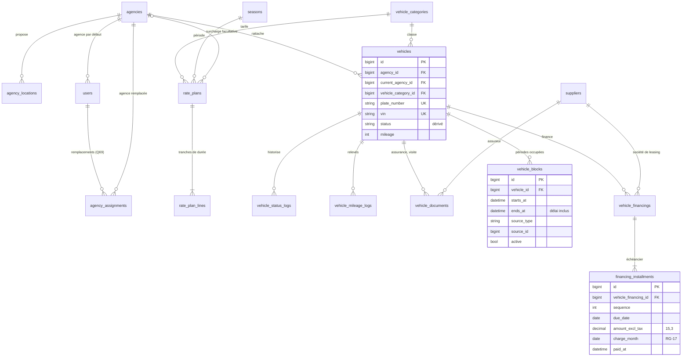
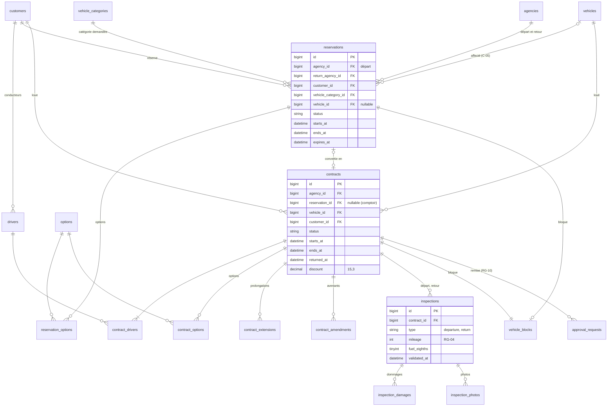
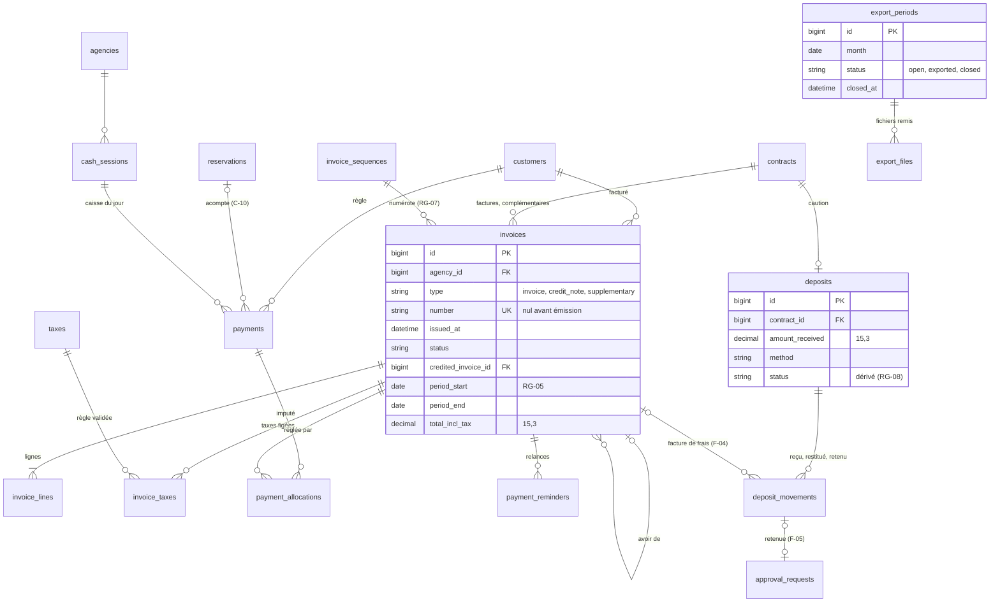
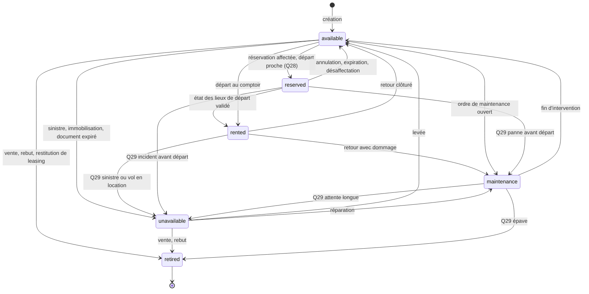

# Architecture — Aviator (Laravel 13, Filament v5, MariaDB 10.11)

Proposition de la phase 1, à valider. Le modèle détaillé (colonnes, index, contraintes) sera livré en phase 2, sous forme de migrations.

Sources : cahier des charges (§4, §5.3), prompt maître (§3, §6, §7), `docs/questions_ouvertes.md`. Les écarts au cahier sont signalés par **[Écart]**, et les choix qui dépendent d'une question par **[Qn]**.

## Sommaire

1. [Principes](#1-principes)
2. [Arborescence](#2-arborescence)
3. [Tables et modèles](#3-tables-et-modèles)
4. [Schéma entité-relation](#4-schéma-entité-relation)
5. [Services de domaine](#5-services-de-domaine)
6. [Mécanismes critiques](#6-mécanismes-critiques)
7. [Machine à états du véhicule](#7-machine-à-états-du-véhicule)
8. [Droits, portée par agence et carnet d'adresses](#8-droits-portée-par-agence-et-carnet-dadresses)
9. [Back-office Filament](#9-back-office-filament)
10. [Paramètres, notifications et tâches planifiées](#10-paramètres-notifications-et-tâches-planifiées)
11. [Préparation du lot 2](#11-préparation-du-lot-2)

---

## 1. Principes

- **Monolithe Laravel** : back-office Filament (`/admin`), puis l'espace client au lot 2 (Blade, Livewire et Tailwind, avec une garde `customer`).
- **Règles métier dans `app/Domain/*`**, sous forme d'**actions** (une classe par opération, méthode `handle()`), appelées par Filament, par les commandes et plus tard par l'espace client. Les ressources Filament ne font que de la saisie et de l'affichage.
- **Une transaction par action** qui touche plusieurs tables. Les verrous de ligne (`lockForUpdate()`) sont posés **avant** les contrôles (RG-02, RG-07, RG-08).
- **Argent** : colonnes `DECIMAL(15,3)`, objet `App\Support\Money` (basé sur `Brick\Math\BigDecimal`, échelle 3) et cast Eloquent `MoneyCast`. Aucun `float`. Le mode d'arrondi des taxes sera fixé par l'expert-comptable **[Q11]**.
- **Dates** : `DATETIME` en base, fuseau `Africa/Tunis` dans l'application **[Q73]**.
- **Documents validés** (factures, avoirs, contrats clôturés, encaissements, recommandations) : jamais supprimés, jamais modifiés après validation (RG-06, RG-11, RG-16). Pas de `SoftDeletes` sur ces modèles : une annulation est un **statut**, accompagné d'un motif et d'une entrée dans le journal d'audit.
- **MariaDB 10.11** (production Oxahost en 10.11.19, Q70 et D12) : connexion Laravel `mariadb`, InnoDB, `utf8mb4_unicode_ci`. Pas de fonctionnalité propre à MySQL 8 : pas d'index fonctionnels (on indexe une colonne générée ou stockée, comme `search_name`), pas d'index JSON, pas de `joinLateral`, pas d'interclassement `utf8mb4_0900_*`. Les colonnes JSON sont des `LONGTEXT` avec contrôle `JSON_VALID` : on n'y fait pas de recherche. Disponibles et utilisables : verrous `FOR UPDATE` et `SKIP LOCKED`, CTE et fonctions de fenêtrage (statistiques), type `UUID` natif. Pas de triggers ni de procédures stockées (droits rarement accordés en mutualisé) : les règles d'intégrité sont dans le code et testées.
- **Pas de multi-tenancy Filament** (`->tenant()`) : elle impose une agence par URL, alors que le super admin et l'admin travaillent sur toutes les agences. La portée par agence repose sur `AgencyScope` et les policies (§8).

## 2. Arborescence

```text
app/
├── Domain/
│   ├── Availability/     # disponibilité, blocages de périodes, verrous (RG-01, RG-02, RG-15)
│   ├── Pricing/          # devis, durée facturée, retards, km, carburant, remises (RG-09, RG-10)
│   ├── Rental/           # [Écart] contrats, départs, retours, prolongations, avenants (RG-03, RG-04)
│   ├── Billing/          # factures, avoirs, numérotation, encaissements, caisse (RG-05 à RG-07, RG-12)
│   ├── Deposits/         # cautions et mouvements (RG-08)
│   ├── Fleet/            # statuts (machine à états), kilométrage, documents, leasing, maintenance
│   ├── Crm/              # recherche limitée, doublons, recommandations, liste noire (RG-14 à RG-16)
│   ├── Approvals/        # [Écart] demandes d'approbation du super admin (remise, retenue, dérogation…)
│   ├── Stats/            # agrégats mensuels, indicateurs I-01 à I-22 (RG-17)
│   └── Exports/          # journaux pour l'expert-comptable, clôture de période
├── Models/
├── Policies/
├── Filament/
│   ├── Resources/  ├── Pages/  ├── Widgets/  └── Forms/Components/   # sélecteur client « recherche exacte »
├── Http/                 # lot 2 ; route contrôlée des fichiers privés
├── Notifications/
├── Console/Commands/
└── Support/              # Money, MoneyCast, AgencyScope, BelongsToAgency, CurrentAgency, Settings
```

**[Écart]** Le prompt maître (§3) ne prévoit ni `Rental/` ni `Approvals/`. Les contrats et les approbations ont pourtant des règles propres (RG-03, RG-04, RG-10, F-05, K-11) : les ranger dans `Pricing` ou `Crm` mélangerait les responsabilités. La maintenance est rangée dans `Fleet/Maintenance`.

---

## 3. Tables et modèles

Colonne « Agence » : ✔ = la table porte `agency_id` et est soumise à `AgencyScope`. Les tables marquées **[Ajout]** ne figurent pas au §5.3 du cahier.

### 3.1 Paramétrage (module A)

| Table | Modèle | Rôle | Agence | Points clés |
| --- | --- | --- | --- | --- |
| `settings` | (spatie/laravel-settings) | Paramètres métier par groupe (`reservations`, `pricing`, `billing`, `crm`, `fleet`, `approvals`, `notifications`, `stats`) | — | Classes typées, valeurs par défaut posées par migration, modifiables par le super admin |
| `company` **[Ajout]** | `Company` | Fiche société A-01 (une ligne) : raison sociale, matricule fiscal, adresse, logo, mentions | — | Les mentions légales ne sont saisies qu'à partir d'une règle validée |
| `agencies` | `Agency` | Les 4 agences, puis d'autres sans développement | — | `code` unique, `is_head_office` |
| `agency_locations` **[Ajout]** | `AgencyLocation` | Lieux de prise en charge et de restitution, horaires (A-02) | ✔ | Horaires en JSON par jour de la semaine |
| `vehicle_categories` | `VehicleCategory` | Catégories (A-03) | — | Surcharges par catégorie : caution, âge et ancienneté de permis, forfait km, franchise **[Q14, Q42 à Q45]** |
| `seasons` **[Ajout]** | `Season` | Saisons datées (A-04) | — | Périodes sans chevauchement |
| `rate_plans`, `rate_plan_lines` | `RatePlan`, `RatePlanLine` | Grilles par catégorie, saison et agence facultative ; tranches de durée (A-04) | — | `agency_id` **nullable** : grille commune ou surcharge d'agence **[Q10, Q33]** |
| `options` | `Option` | Options facturables (A-05) | — | Tarification par jour ou par location, plafond facultatif |
| `taxes` | `Tax` | Taxes avec date d'effet (A-08) | — | `kind` (taux ou montant fixe), `rate`, `amount`, `applies_to`, `valid_from`, `valid_to`, `source_document`, `validated_by`, `validated_at`. **Vide tant qu'aucune règle n'est déposée** [Q11] |
| `payment_methods` **[Ajout]** | `PaymentMethod` | Espèces, chèque, carte, virement, traite (A-07, E-06) | — | Liste paramétrable |
| `suppliers` | `Supplier` | Fournisseurs, garages, assureurs, sociétés de leasing (G-05) | — | `type`, matricule fiscal |

### 3.2 Parc, leasing et maintenance (modules B et G)

| Table | Modèle | Rôle | Agence | Points clés |
| --- | --- | --- | --- | --- |
| `vehicles` | `Vehicle` | Fiche véhicule (B-01 à B-04, B-10) | ✔ (rattachement) | `plate_number` et `vin` uniques ; `status` dérivé ; `current_agency_id` (localisation) ; `mileage` ; données d'acquisition |
| `vehicle_status_logs` | `VehicleStatusLog` | Historique des statuts (B-09) | — | De, vers, cause (modèle source), utilisateur, date. Ajout seul |
| `vehicle_mileage_logs` **[Ajout]** | `VehicleMileageLog` | Relevés et corrections de kilométrage (B-03) | — | Une baisse n'est possible que par une correction motivée, journalisée (J-04) |
| `vehicle_documents` **[Ajout]** | `VehicleDocument` | Assurance, visite technique, vignette, avec leur historique (B-05) | — | `type`, fournisseur, référence, `valid_from`, `valid_until` ; le document actif bloque ou permet le départ |
| `vehicle_blocks` **[Ajout]** | `VehicleBlock` | **Périodes d'occupation** d'un véhicule : réservation affectée, contrat, maintenance, immobilisation | — | `vehicle_id`, `starts_at`, `ends_at` (délai de préparation inclus), source polymorphe, `active`. Index (`vehicle_id`, `active`, `starts_at`, `ends_at`). Voir §6.1 |
| `vehicle_financings` | `VehicleFinancing` | Leasing ou crédit (B-11, B-14, B-15) | — | `type` (leasing, crédit), organisme, référence, dates, apport, loyer HT et TTC, valeur résiduelle, option d'achat, issue |
| `financing_installments` | `FinancingInstallment` | Échéancier (B-12) | — | `due_date`, montants, `paid_at` (pointage), `charge_month` (RG-17) ; unique (`vehicle_financing_id`, `sequence`) |
| `maintenance_plans` **[Ajout]** | `MaintenancePlan` | Entretien préventif par km ou par date (G-01) | — | Intervalle en km ou en mois, dernière exécution |
| `maintenance_orders` | `MaintenanceOrder` | Entretiens, réparations, contrôles (G-02, G-03) | — | `type`, fournisseur, période prévue et réelle, montant, statut ; crée un `vehicle_block` |
| `incidents` | `Incident` | Sinistres (G-06) | — | Contrat lié facultatif, montants estimé et indemnisé, tiers, assureur |
| `vehicle_unavailabilities` **[Ajout]** | `VehicleUnavailability` | Immobilisations et leur motif (G-07) | — | Période et motif ; crée un `vehicle_block` |
| `expenses` | `Expense` | Dépenses par véhicule (G-04) | ✔ | `nature` (liste fermée **sans** loyer de leasing, compté via l'échéancier), `charge_month` obligatoire (RG-17), fournisseur, justificatif |

### 3.3 Réservations et contrats (modules C et D)

| Table | Modèle | Rôle | Agence | Points clés |
| --- | --- | --- | --- | --- |
| `reservations` | `Reservation` | Réservations (C-01 à C-10) | ✔ (agence de départ) | `number` ; statuts `draft`, `pending` [Q31], `confirmed`, `cancelled`, `expired`, `no_show` [Q31], `converted` ; catégorie ; véhicule facultatif (C-05) ; agences de départ et de retour ; devis figé ; `expires_at` ; `channel` (`counter` ou `online` au lot 2) |
| `reservation_options` **[Ajout]** | — | Options d'une réservation | — | Prix figé |
| `contracts` | `Contract` | Contrats (D-01 à D-11) | ✔ (agence de départ) | `number` ; réservation facultative (saisie comptoir, RG-03) ; véhicule ; client ; dates prévues et réelles ; conditions km et carburant ; remise et statut d'approbation ; statuts `draft`, `active`, `returned`, `closed`, `cancelled` |
| `contract_drivers` | — | Conducteurs autorisés | — | Pivot (`contract_id`, `driver_id`, `is_primary`) |
| `contract_options` | `ContractOption` | Options du contrat | — | Prix figé |
| `contract_extensions` **[Ajout]** | `ContractExtension` | Prolongations (D-07) | — | Ancienne et nouvelle date de fin, contrôle de disponibilité tracé |
| `contract_amendments` **[Ajout]** | `ContractAmendment` | Avenants sur contrat clôturé (D-11) | — | Motif, auteur, différences |
| `inspections` | `Inspection` | États des lieux de départ et de retour (D-06) | — | `type` (départ ou retour), km, carburant en huitièmes, signature (fichier privé), validé le, par ; unique (`contract_id`, `type`) |
| `inspection_damages` | `InspectionDamage` | Dommages placés sur le schéma | — | Zone, coordonnées, description, gravité |
| `inspection_photos` | `InspectionPhoto` | Photos compressées (disque `private`) | — | Chemin, taille, empreinte |

### 3.4 Facturation, encaissements, cautions, exports (modules E, F et H)

| Table | Modèle | Rôle | Agence | Points clés |
| --- | --- | --- | --- | --- |
| `invoices` | `Invoice` | Factures, avoirs, factures complémentaires (E-01 à E-05) | ✔ | `type` (`invoice`, `credit_note`, `supplementary`) ; `number` **nul jusqu'à l'émission** ; `issued_at` ; `status` (`draft`, `issued`, `cancelled_by_credit`) ; `credited_invoice_id` (avoir) ; période facturée (`period_start`, `period_end`) pour RG-05 ; client figé (nom, matricule fiscal, adresse) |
| `invoice_lines` | `InvoiceLine` | Lignes : location, options, frais | — | Quantité, prix unitaire HT, remise, nature (pour la TVA par nature) |
| `invoice_taxes` | `InvoiceTax` | Taxes appliquées, figées à l'émission | — | Copie de la règle `taxes` en vigueur (taux, référence) |
| `invoice_sequences` | — | Compteurs de numérotation (RG-07) | — | Clé de séquence (année, et selon Q11/Q30 : agence, type), `last_number` ; ligne verrouillée à l'émission |
| `payments` | `Payment` | Encaissements et acomptes (E-06, C-10) | ✔ | Mode, référence, montant, `received_at`, client, réservation facultative (acompte), `cash_session_id` |
| `payment_allocations` | `PaymentAllocation` | Imputation d'un encaissement sur une ou plusieurs factures | — | Somme imputée ≤ montant encaissé ; ≤ reste dû de la facture |
| `payment_reminders` **[Ajout]** | `PaymentReminder` | Historique des relances (E-08) | — | Canal [Q53], date, auteur, suite donnée |
| `cash_sessions` **[Ajout]** | `CashSession` | Journal de caisse par agence et par jour (E-09) | ✔ | Ouverture, clôture, totaux par mode, écart et motif [Q55] |
| `deposits` | `Deposit` | Cautions (F-01 à F-08) | ✔ | Montant reçu, mode, référence (jamais de numéro de carte, [Q54]), statut dérivé des mouvements |
| `deposit_movements` | `DepositMovement` | Réception, restitution, retenue | — | `type`, montant, justificatif, facture de frais liée, approbation liée ; ajout seul |
| `export_periods` | `ExportPeriod` | Périodes exportées et clôturées (H-06, RG-12) | — | Mois, statut, clôturée par, le ; empreinte des fichiers exportés |
| `export_files` **[Ajout]** | `ExportFile` | Fichiers produits (journal, format, empreinte SHA-256) | — | Traçabilité de ce qui a été remis à l'expert-comptable |

### 3.5 CRM (module K)

| Table | Modèle | Rôle | Agence | Points clés |
| --- | --- | --- | --- | --- |
| `customers` | `Customer` | Clients particuliers et entreprises (K-01) | ✔ (agence d'origine, **sans** scope en lecture : voir §8.3) | Identité, type, matricule fiscal, coordonnées, source, parrain (K-13). **Colonnes de recherche normalisées** : `search_name`, `phone_e164`, plus les empreintes HMAC des numéros de pièce et de permis (§6.5) |
| `drivers` | `Driver` | Conducteurs (D-02), dont le client lui-même [Q47] | — | Pièce et permis (dates d'obtention et d'expiration), empreintes de recherche |
| `customer_recommendations` | `CustomerRecommendation` | Recommandations et liste noire (K-08 à K-11) | — | Niveau, motif (liste fermée [Q17]), commentaire, auteur, contrat, `status` (`effective` ou `proposed`), approbation liée. **Ajout seul** (RG-16) |
| `customer_interactions` | `CustomerInteraction` | Journal des interactions (K-14) | ✔ | Type, sujet, suite donnée |
| `complaints` | `Complaint` | Réclamations (K-15) | ✔ | Responsable, statut, échéance |
| `customer_segments`, `customer_segment_members` | `CustomerSegment` | Segments (K-16) | — | Super admin [Q27] ; segments dynamiques calculés, statiques mémorisés |
| `customer_consents` | `CustomerConsent` | Consentements commerciaux, datés (K-07) | — | Ajout seul (historique) |
| `customer_search_grants` **[Ajout]** | — | Accès temporaires à une fiche après une recherche exacte [Q64] | — | Utilisateur, client, expiration. Voir §8.3 |
| `customer_follow_ups` **[Ajout]** | `CustomerFollowUp` | Rappels de suivi (K-17) | — | Date, assigné à, fait le |

### 3.6 Administration, approbations, notifications, statistiques (modules I et J)

| Table | Modèle | Rôle | Agence | Points clés |
| --- | --- | --- | --- | --- |
| `users` | `User` | Les 6 comptes (J-01) | — | `agency_id` (agence par défaut), `is_active`, champs 2FA de Filament |
| `agency_assignments` **[Ajout]** | `AgencyAssignment` | Remplacements à durée limitée dans une autre agence [Q69] | — | Dates de début et de fin incluses (Africa/Tunis) ; créées par le super admin, journalisées |
| `roles`, `permissions`, `model_has_*` | (Spatie) | 3 rôles fixes (J-02) | — | Créés par seeder ; pas d'éditeur de rôles dans l'interface (§9.3) |
| `activity_log` | (Spatie) | Audit et historique avant/après (J-04, J-05), consultations du carnet (RG-14) | — | Journaux nommés : `audit`, `customer_access`, `security` |
| `approval_requests` **[Ajout]** | `ApprovalRequest` | Demandes au super admin : remise (RG-10), retenue (F-05), liste noire (K-11), dérogation (RG-15) | ✔ | `type`, sujet polymorphe, demandeur, `status` (`pending`, `approved`, `rejected`, `cancelled`), décideur, décision le, commentaire ; données de la demande figées |
| `notifications` | (Laravel) | Centre de notifications (J-13) | — | Canal `database` |
| `push_subscriptions` | (webpush) | Appareils abonnés (J-12, RG-20) | — | Polymorphe : `User` puis `Customer` au lot 2 |
| `notification_preferences` **[Ajout]** | `NotificationPreference` | Types d'alertes reçus par utilisateur (J-13) | — | Valeur par défaut posée par migration |
| `imports` **[Ajout]** | `Import` | Imports Excel (J-07, K-06) et rapports d'anomalies | — | Fichier, type, statut, compteurs, rapport (disque privé). Super admin |
| `kpi_monthly_vehicle` | `KpiMonthlyVehicle` | Agrégats mensuels par véhicule (I-01 à I-16) | ✔ | Unique (`vehicle_id`, `month`) ; charges par nature, CA HT net, jours loués et disponibles, km |
| `jobs`, `failed_jobs`, `cache`, `sessions` | (Laravel) | File, cache et sessions en base (mutualisé) | — | — |

**Total** : environ 60 tables, dont 23 ajoutées au §5.3, la plupart techniques (historiques, pivots, rapports).

---

## 4. Schéma entité-relation

Le modèle est découpé en quatre schémas pour rester lisible. Les attributs ne montrent que les clés et les colonnes qui portent une règle.

### 4.1 Référentiels et parc



### 4.2 Cycle de location



### 4.3 Facturation, encaissements, cautions et exports



### 4.4 Maintenance, CRM et administration

```mermaid
erDiagram
    vehicles ||--o{ maintenance_plans : "préventif"
    vehicles ||--o{ maintenance_orders : "interventions"
    suppliers |o--o{ maintenance_orders : "garage"
    vehicles ||--o{ expenses : "dépenses"
    suppliers |o--o{ expenses : "fournisseur"
    vehicles ||--o{ incidents : "sinistres"
    contracts |o--o{ incidents : "pendant la location"
    vehicles ||--o{ vehicle_unavailabilities : "immobilisations"
    maintenance_orders ||--o| vehicle_blocks : "bloque"
    vehicle_unavailabilities ||--o| vehicle_blocks : "bloque"
    vehicles ||--o{ kpi_monthly_vehicle : "agrégats"

    customers ||--o{ customer_recommendations : "ajout seul (RG-16)"
    users ||--o{ customer_recommendations : "auteur"
    contracts |o--o{ customer_recommendations : "contrat concerné"
    customers ||--o{ customer_interactions : ""
    customers ||--o{ complaints : ""
    customers ||--o{ customer_consents : ""
    customers ||--o{ customer_follow_ups : ""
    customer_segments }o--o{ customers : "membres"
    users ||--o{ customer_search_grants : "accès temporaire"
    customers ||--o{ customer_search_grants : ""

    users ||--o{ approval_requests : "demande, décide"
    users ||--o{ push_subscriptions : "appareils"
    users ||--o{ notification_preferences : ""
    users ||--o{ imports : "lance"

    customer_recommendations {
        bigint id PK
        bigint customer_id FK
        bigint author_id FK
        string level "recommended, standard, watch, blacklist"
        string reason_code
        string status "effective, proposed"
        datetime created_at
    }
    approval_requests {
        bigint id PK
        bigint agency_id FK
        string type "discount, retention, blacklist, override"
        string subject_type
        bigint subject_id
        string status
        bigint decided_by FK
    }
```



---

## 5. Services de domaine

Une action = une classe dans `app/Domain/<Contexte>/Actions`, avec une méthode `handle()` qui s'exécute dans une transaction. Les requêtes en lecture vont dans `Queries/`. Chaque règle de gestion a au moins un test dédié.

| Contexte | Actions et services | Règles | Phase |
| --- | --- | --- | --- |
| **Availability** | `AvailabilityQuery` (véhicules et capacité par catégorie), `BlockRegistry` (crée, déplace et libère les `vehicle_blocks`), `VehicleLock` (verrouille véhicule et catégorie), `CustomerRiskGate` (liste noire, vigilance, dérogation) | RG-01, RG-02, RG-15, RG-18 | 4 |
| **Availability** (réservations) | `CreateReservation`, `ModifyReservation`, `ConfirmReservation`, `CancelReservation` (motif obligatoire), `AssignVehicle`, `ExpireReservations`, `MarkNoShow` | C-03 à C-09, RG-21 | 4 |
| **Pricing** | `QuoteCalculator` (renvoie un objet `PriceQuote` figé), `BillableDurationCalculator` [Q32], `RateResolver` (grille, saison, agence) [Q33], `LateFeeCalculator` (RG-09), `MileageFeeCalculator`, `FuelFeeCalculator`, `DiscountPolicy` (seuil, approbation requise) | RG-09, RG-10 | 4, 5 |
| **Rental** | `OpenContract` (depuis une réservation ou au comptoir, contrôle immédiat), `ValidateDriver` (âge, permis) [Q42], `StartRental` (état des lieux de départ, documents du véhicule valides), `ExtendContract` (nouvelle disponibilité), `RegisterReturn` (état des lieux de retour, frais), `CloseContract`, `AmendContract` | RG-03, RG-04, D-03, D-07, D-11 | 5 |
| **Billing** | `IssueInvoice`, `IssueSupplementaryInvoice`, `IssueCreditNote`, `InvoiceNumberAllocator`, `FiscalRulesGuard` (« Règle fiscale non validée »), `RecordPayment`, `AllocatePayment`, `OpenCashSession`, `CloseCashSession`, `ClosedPeriodGuard` | RG-05 à RG-07, RG-11, RG-12 | 6 |
| **Deposits** | `ReceiveDeposit`, `RequestRetention`, `ApplyRetention` (après approbation), `RefundDeposit`, `DepositBalance` | RG-08, F-05, F-07 | 6 |
| **Fleet** | `VehicleStatusService` (seul à écrire `vehicles.status`), `StatusConsistencyCheck` (commande de contrôle), `RecordMileage`, `CorrectMileage`, `DocumentExpiryWatcher`, `GenerateFinancingSchedule`, `MarkInstallmentPaid`, `SettleFinancing` (levée d'option ou restitution), `RetireVehicle` | §7, B-03, B-07, B-12 à B-14 | 4 |
| **Fleet/Maintenance** | `OpenMaintenanceOrder`, `CloseMaintenanceOrder`, `DeclareIncident`, `RecordUnavailability`, `RecordExpense`, `MaintenanceDueWatcher` | G-01 à G-07, RG-17 | 8 |
| **Crm** | `CustomerLookup` (recherche exacte et accès temporaire), `DuplicateDetector`, `RegisterCustomer`, `AddRecommendation`, `ProposeBlacklist`, `ImportCustomers` (rapport de doublons), `RecordInteraction`, `RecordConsent`, `AddressBookQuery` (super admin, journalisée) | RG-14, RG-16, K-05, K-06 | 7 |
| **Approvals** | `RequestApproval` (fige les données, notifie le super admin), `DecideApproval` (contrôle le rôle et l'état, rappelle l'action d'origine), `ApprovalInbox` | RG-10, F-05, K-11, RG-15 | 5 (générique), 6, 7 |
| **Stats** | `AggregateVehicleMonth` (un véhicule, un mois, idempotent), `RebuildDirtyMonths` (mois touchés par un avoir ou une dépense rétroactive), `KpiQuery` (I-01 à I-22), `ProfitabilityCalculator` [Q19, Q57 à Q59] | RG-17, scénarios 15 et 16 | 9 |
| **Exports** | `SalesJournalExport`, `PaymentsJournalExport`, `DepositsStatementExport`, `ExpensesJournalExport` (format [Q1]), `ClosePeriod` | H-01 à H-06, RG-12 | 8 |

---

## 6. Mécanismes critiques

### 6.1 Disponibilité et anti-chevauchement (RG-01, RG-02)

Toute occupation d'un véhicule écrit une ligne dans `vehicle_blocks` : réservation confirmée avec véhicule, contrat, ordre de maintenance, immobilisation. La fin du blocage inclut le délai de préparation. Le contrôle RG-01 se fait alors **en une seule requête sur une seule table** :

```sql
SELECT 1 FROM vehicle_blocks
WHERE vehicle_id = ? AND active = 1
  AND starts_at < ?   -- fin demandée + délai de préparation
  AND ends_at   > ?   -- début demandé
  AND NOT (source_type = ? AND source_id = ?)   -- pour une modification
LIMIT 1
```

Séquence de chaque action d'occupation, dans une transaction :

1. `SELECT … FROM vehicles WHERE id = ? FOR UPDATE` (et la ligne de la catégorie pour une réservation sans véhicule).
2. Contrôles : statut et documents du véhicule, `CustomerRiskGate`, intersection.
3. Écriture du document et du `vehicle_block`.
4. Validation de la transaction. La deuxième saisie simultanée attend le verrou, puis voit la première occupation.

**Réservation par catégorie** (C-05) **[Q36]** : la capacité est le nombre de véhicules louables de la catégorie, moins les réservations sans véhicule qui chevauchent la période, moins les véhicules bloqués. Le verrou porte sur la ligne `vehicle_categories`.

**Test de concurrence** (scénario 1, phase 4) : deux connexions distinctes à la base (`mariadb` et `mariadb_concurrent`) sur `aviator_test`. La première prend le verrou et garde la transaction ouverte ; la seconde est lancée dans un processus PHP séparé, puis on vérifie qu'une seule réservation existe. Sous Windows, il n'y a pas de `pcntl` : le second processus est lancé avec `Symfony\Process`.

### 6.2 Numérotation des factures (RG-07)

- Numéro attribué **à l'émission**, jamais au brouillon.
- Dans la transaction d'émission : `SELECT … FROM invoice_sequences WHERE sequence_key = ? FOR UPDATE`, puis incrément et écriture. Une émission qui échoue annule aussi l'incrément : il n'y a pas de trou.
- Chronologie : l'émission refuse une date antérieure à la dernière facture émise sur la même séquence.
- Clé et format de séquence **[Q11, Q30]** : non paramétrés tant qu'ils ne sont pas validés. `FiscalRulesGuard` refuse l'émission en production.

### 6.3 Factures verrouillées et périodes clôturées (RG-06, RG-11, RG-12)

- Après émission, `Invoice::updating` lève une exception si une colonne autre que les colonnes techniques change. `deleting` est toujours refusé. La policy n'expose ni `update` ni `delete`.
- `ClosedPeriodGuard` est appelé par toute action qui crée ou modifie une facture, un avoir ou un encaissement : il refuse toute date qui tombe dans une période clôturée.

### 6.4 Cautions (RG-08)

Toute action verrouille la ligne `deposits`, recalcule le solde à partir des mouvements (`reçu − restitué − retenu`), puis refuse tout dépassement. L'état de la caution est **dérivé** de ce solde, jamais saisi.

### 6.5 Données personnelles et recherche exacte

- Numéros de pièce et de permis : chiffrés en base (cast `encrypted`), plus une colonne d'**empreinte HMAC** (clé dans `.env`) qui permet la recherche exacte sans stocker le numéro en clair. Le nom normalisé (`search_name`) et le téléphone au format E.164 sont indexés.
- Fichiers (pièces, photos, signatures) : disque `private` (`storage/app/private`), servis par une route contrôlée par policy. Photos compressées à l'envoi (Intervention Image, 1600 px de côté maximum, JPEG qualité 75).

---

## 7. Machine à états du véhicule

Proposition conforme au §6 du prompt et au §5.1 du cahier, **plus les transitions de Q29** (en pointillés), sous réserve de validation.



- `VehicleStatusService::transition(Vehicle, VehicleStatus, cause)` est le seul point d'écriture. Une transition absente du tableau lève `IllegalVehicleTransition`, et chaque transition écrit dans `vehicle_status_logs`.
- Le statut est recalculé à partir des opérations (contrats actifs, maintenances ouvertes, immobilisations, documents). La commande `fleet:check-status` signale chaque nuit les écarts.
- Le départ est refusé si l'assurance ou la visite technique n'est pas valide **à la date de départ** (scénario 10). Une alerte est émise si elle expire **pendant** la location prévue.

---

## 8. Droits, portée par agence et carnet d'adresses

### 8.1 Rôles et permissions

Trois rôles fixes, créés par seeder : `super_admin`, `admin`, `agency_user` ; `customer` passe par une garde séparée au lot 2. Les permissions sont nommées `<ressource>.<action>` (par exemple `invoices.issue`, `customers.address_book`, `customers.export`). Les policies vérifient la permission **et** la portée par agence.

| Domaine | super_admin | admin | agency_user |
| --- | --- | --- | --- |
| Paramétrage, tarifs, taxes | Écriture | Écriture (taxes en lecture) | — |
| Utilisateurs, rôles, journal d'audit | Écriture | — | — |
| Parc, leasing, maintenance, dépenses | Écriture | Écriture | Lecture du parc de son agence |
| Disponibilité, planning | Toutes agences | Toutes agences | Toutes agences en lecture, **sans nom de client** hors de son agence [Q38] |
| Réservations, contrats, états des lieux | Toutes agences | Toutes agences | Son agence (RG-13) |
| Factures, avoirs, encaissements | Toutes agences | Toutes agences | Son agence ; pas d'avoir ni d'annulation |
| Cautions : réception et restitution | Oui | Oui | Son agence |
| Cautions : retenue | Approuve | Demande | Demande |
| Remise au-delà du seuil | Approuve | Demande | Demande |
| Liste noire | Valide | Propose | Propose |
| Recherche client exacte, fiche « contrat » | Oui | Oui | Oui |
| **Carnet d'adresses** : coordonnées des clients en liste (téléphone, e-mail, adresse, pièce, permis) (RG-14, D13) | **Oui, journalisé** | — | — |
| **Tout export de fichier clients**, depuis n'importe quel écran (RG-14, D13) | **Oui, journalisé** | — | — |
| Noms des clients dans les listes métier : ventes, impayés, meilleurs clients (I-19), segments (K-16), statistiques clients (I-18) | Oui | Lecture, **sans coordonnées ni export** | Noms dans les documents de son agence ; ni segments ni statistiques clients |
| Envois groupés de notifications aux clients (K-18, lot 2) | Oui | — | — |
| Exports pour l'expert-comptable, clôture | Oui | Oui (client : **nom et matricule fiscal seulement**, D13) | — |
| Statistiques | Toutes | Toutes ; exports en agrégats, sans colonne client (D13) | Activité de son agence [Q61] |
| Imports Excel | Oui | — | — |

### 8.2 Portée par agence (RG-13)

Réalisé en phase 2 (lot 4), dans `app/Support/Agency` :

- **Lecture** : le trait `BelongsToAgency`, posé sur les modèles marqués ✔, ajoute le global scope `AgencyScope`. Pour un utilisateur sans la permission `agencies.all` (utilisateur d'agence), les requêtes sont restreintes à ses agences autorisées : agence par défaut et agences de remplacement (Q69). Un compte sans agence ne voit rien. Le scope est sans effet pour le super admin, l'admin et les traitements sans utilisateur connecté (commandes, tâches, file).
- **Écriture** : `BelongsToAgency` refuse, à l'enregistrement, toute création ou modification hors des agences autorisées, y compris le déplacement d'un document vers une autre agence (`AgencyAccessException`, réponse 403). Le contrôle vaut même si le scope est contourné ou si le formulaire est falsifié. Un nouveau document d'un utilisateur d'agence reçoit son **agence active** (`CurrentAgency` : agence choisie pendant la session si elle est autorisée, sinon l'agence par défaut). Le super admin et l'admin choisissent l'agence de chaque document.
- **Policies** : le trait `ChecksAgency` (`withinAgency()`) vérifie l'agence du document, indépendamment du scope.
- **Accès direct par l'adresse** : un document d'une autre agence est **introuvable** (404), le scope l'excluant de la liaison de route ; une action ou une écriture hors portée reçoit un **refus** (403).
- La lecture de la disponibilité des autres agences passera par `AvailabilityQuery` (phase 4), qui renvoie une projection sans donnée client, jamais par les ressources.
- Tests : `tests/Feature/Agency/AgencyScopeTest.php`, sur un modèle de test (`tests/Fixtures`). Le scénario 12 complet (contrat de Sousse modifié depuis Sfax) sera rejoué sur chaque type de document à mesure qu'il apparaît (phases 4 à 8).
- **Interface de changement d'agence active** : le service est prêt ; le sélecteur dans le menu utilisateur sera ajouté avec les premiers documents d'agence (phase 4).

### 8.3 Carnet d'adresses : fuites à fermer (RG-14)

`Customer` n'est **pas** soumis à `AgencyScope` (un client peut louer partout). L'accès est contrôlé ainsi :

| Point de fuite | Mesure |
| --- | --- |
| Liste des clients (`CustomerResource::index`) | Policy `viewAny` réservée au super admin. Les autres profils ont une page « Rechercher un client » sans liste |
| Fiche ouverte en changeant le numéro dans l'adresse | `view` autorisé seulement avec un accès temporaire valide (`customer_search_grants`, 8 h) ou un document actif de son agence [Q64]. Sinon refus, journalisé |
| Recherche globale Filament | `CustomerResource::$isGloballySearchable = false`. Recherche globale des autres ressources sans colonne client |
| Sélecteurs de relation (client d'une réservation, d'un contrat) | Composant `CustomerLookupSelect` : pas de `preload()`, recherche exacte uniquement (`getSearchResultsUsing` → `CustomerLookup`), 5 résultats au maximum |
| Exports de tableaux | Aucune `ExportAction` ni `ExportBulkAction` exposant des colonnes client, sauf pour le super admin (carnet et listes). Exceptions : journaux comptables (nom et matricule fiscal). Exports de l'admin : agrégats seulement (D13) |
| Filtres de tables | Pas de filtre « client » avec liste de choix |
| Impayés, relances, journal des ventes | Noms seulement, sans coordonnées ; journal des ventes : nom et matricule fiscal (D13) |
| Statistiques clients (I-18, I-19), segments | Admin : noms à l'écran, sans coordonnées ni export ; super admin : complet (D13) |
| Envois groupés aux clients (K-18, lot 2) | Policy réservée au super admin |
| Journal d'audit (contient des valeurs avant/après) | Super admin |
| Rapports d'import | Super admin |
| État Livewire | Pas de tableau de clients en propriété publique d'un composant |
| Énumération par la recherche | Limite de 30 recherches par heure et par utilisateur ; journal `customer_access` |

Test (scénario 13) : l'admin et l'utilisateur d'agence reçoivent un refus sur le carnet, l'export et la fiche sans accès temporaire, et chaque tentative est journalisée. Un test d'architecture (Pest arch) interdit `ExportAction` dans les ressources liées aux clients.

### 8.4 Authentification

- 2FA obligatoire pour `super_admin` et `admin` (J-03) : authentification multifacteur intégrée à Filament v5 (application TOTP), plus des codes de récupération.
- Limitation des tentatives de connexion, sessions en base, HTTPS forcé, en-têtes de sécurité (middleware).

---

## 9. Back-office Filament

### 9.1 Panneau

Un seul panneau, `admin` (`/admin`) : `->spa()`, barre latérale repliable, thème clair, couleurs de la charte [Q6]. Le tableau de bord dépend du profil. Le centre de notifications intégré de Filament (`databaseNotifications()`) sert pour J-13. Un *render hook* ajoute le manifeste PWA et enregistre le service worker.

### 9.2 Navigation, ressources et pages

| Groupe | Élément | Type | Profils | Phase |
| --- | --- | --- | --- | --- |
| Accueil | Tableau de bord (selon le profil) | Page + widgets | Tous | 4, puis 9 |
| Accueil | **Approbations** (boîte de réception, adaptée au téléphone) | Page | super_admin (décision), autres (suivi de leurs demandes) | 5 |
| Comptoir | **Nouvelle location** (assistant : client → période → véhicule → options → devis → réservation ou contrat) | Page Livewire | Tous | 4, 5 |
| Comptoir | **Départs et retours du jour** | Page | Tous | 5 |
| Comptoir | **Disponibilité** (recherche C-01) | Page | Tous | 4 |
| Comptoir | **Planning** (frise par véhicule) | Page (`guava/calendar`, vue *resource timeline* ; prototype obligatoire au début de la phase 4, repli : frise Livewire maison, D5) | Tous | 4 |
| Locations | Réservations | `ReservationResource` | Tous (scope) | 4 |
| Locations | Contrats (actions : départ, retour, prolonger, avenant, imprimer) | `ContractResource` + pages d'état des lieux pour tablette | Tous (scope) | 5 |
| Facturation | Factures et avoirs | `InvoiceResource` (actions : émettre, avoir, complémentaire, PDF) | Tous (scope ; avoir : admin et super_admin) | 6 |
| Facturation | Encaissements | `PaymentResource` | Tous (scope) | 6 |
| Facturation | Impayés et relances | Page + `PaymentReminderResource` | admin, super_admin ; agence en lecture | 6 |
| Facturation | Caisse du jour | `CashSessionResource` | Tous (scope) | 6 |
| Facturation | Cautions | `DepositResource` | Tous (scope) | 6 |
| Clients | **Rechercher un client** | Page | Tous | 7 |
| Clients | **Carnet d'adresses** (liste, filtres, export) | `CustomerResource` (index) | super_admin | 7 |
| Clients | Fiche client (vue d'ensemble K-02) | `CustomerResource` (vue + gestionnaires de relations) | Tous, selon §8.3 | 7 |
| Clients | Recommandations (ajout seul) | Gestionnaire de relation + action « Proposer liste noire » | Tous | 7 |
| Clients | Interactions, réclamations, rappels | Ressources | Tous (scope) | 7 |
| Clients | Segments | `CustomerSegmentResource` | super_admin ; admin en lecture (noms seuls, sans export, D13) | 7 |
| Parc | Véhicules (documents, kilométrage, statuts, historique B-06) | `VehicleResource` + gestionnaires de relations | admin, super_admin ; agence en lecture | 4 |
| Parc | Financements (leasing, crédit, échéancier, pointage) | `VehicleFinancingResource` | admin, super_admin | 4 |
| Parc | Maintenance, plans d'entretien, sinistres, immobilisations | Ressources | admin, super_admin | 8 |
| Parc | Dépenses | `ExpenseResource` | admin, super_admin | 8 |
| Pilotage | **Statistiques** (filtres mois, année, agence, catégorie, véhicule ; graphiques ; export Excel) | Pages + widgets (graphiques Chart.js intégrés à Filament) | super_admin, admin ; agence : activité | 9 |
| Pilotage | **Rentabilité d'un véhicule** (adaptée au téléphone) | Page | super_admin, admin | 9 |
| Pilotage | Exports pour l'expert-comptable, clôture de période | Page + `ExportPeriodResource` | admin, super_admin | 8 |
| Paramétrage | Société, agences et lieux, catégories, saisons, grilles, options, modes de paiement, fournisseurs | Ressources + page de société | admin, super_admin | 3 |
| Paramétrage | Taxes (avec document de référence) | `TaxResource` | super_admin (écriture), admin (lecture) | 3, 6 |
| Paramétrage | Règles (réservation, tarification, facturation, CRM, approbations, notifications) | Pages `spatie/laravel-settings` | super_admin | 3 |
| Administration | Utilisateurs et rattachements | `UserResource` | super_admin | 2 |
| Administration | Journal d'audit | Page (lecture `activity_log`) | super_admin | 2 |
| Administration | Imports Excel | Page + `ImportResource` | super_admin | 7, 10 |
| Profil | Préférences de notification, 2FA, appareils | Page de profil | Tous | 2, 9 |

### 9.3 Choix de conception

- **Pas d'éditeur de rôles dans l'interface** (`bezhansalleh/filament-shield` non retenu) : trois rôles fixes, des permissions créées par seeder et des policies écrites à la main. C'est moins de surface d'attaque et la matrice des droits reste lisible dans le code. Le super admin rattache seulement les utilisateurs à un rôle et à des agences.
- **Saisie au comptoir et état des lieux** : pages Livewire dédiées, pensées pour une tablette (boutons de 48 px, un geste par étape), avec la signature (`saade/filament-autograph`) et la prise de photo par `<input type="file" accept="image/*" capture="environment">`.
- **Pages mobiles du super admin** (approbations, rentabilité, tableau de bord) : composants Filament standard en disposition sur une colonne, testés sur Android et iPhone (scénario 21).

---

## 10. Paramètres, notifications et tâches planifiées

### 10.1 Paramètres (`settings`)

Toutes les valeurs par défaut viennent de `docs/questions_ouvertes.md`. Groupes : `reservations` (durée minimale, préavis, délai de préparation, expiration, non-présentation, restitution dans une autre agence), `pricing` (mode de calcul des jours, tolérance et unité de retard, carburant), `billing` (conditions de paiement, facturation des longues durées, envoi par e-mail désactivé), `approvals` (seuils de remise par profil, délégation), `crm` (nombre de résultats de recherche, durée de l'accès temporaire, limite de recherches, téléphone sur un contrat actif), `fleet` (fenêtre du statut « Réservé », durée de détention, délais d'alerte), `notifications` (délais des alertes A-09), `stats` (répartition des coûts annuels, seuils I-10 et I-16), `storage` (seuil d'alerte disque : 80 %).

### 10.2 Notifications (push et `database`, sans donnée sensible : RG-20, J-14)

| Événement | Destinataire | Texte (générique) |
| --- | --- | --- |
| Demande d'approbation (remise, retenue, liste noire, dérogation) | super_admin | « Nouvelle demande d'approbation à traiter » |
| Décision rendue | Demandeur | « Votre demande a reçu une réponse » |
| Assurance, visite, entretien, fin de leasing ou levée d'option à échéance | admin, agence de rattachement | « Une échéance de véhicule approche » |
| Retard de restitution | Agence du contrat, admin | « Une restitution est en retard » |
| Réservations du jour | Agence | « Départs prévus aujourd'hui : consultez le planning » |
| Alerte de recommandation à la recherche ou à la réservation | Utilisateur concerné (dans la page), super_admin | « Un client signalé a été consulté » |
| Espace disque au-delà du seuil | super_admin | « Espace de stockage : seuil atteint » |

### 10.3 Tâches planifiées (un seul cron : `* * * * * php artisan schedule:run`)

| Tâche | Fréquence | Remarque |
| --- | --- | --- |
| `queue:work --stop-when-empty --max-time=50` | Chaque minute, `withoutOverlapping()` | Envoi des push, PDF lourds, imports |
| `reservations:expire` (C-09, RG-21) | Toutes les 5 min | Idempotente |
| `reservations:flag-no-show` [Q39] | Toutes les 15 min | Proposition seulement, l'agence confirme |
| `fleet:check-documents`, `fleet:maintenance-due`, `financing:due-alerts` | Chaque jour à 06:00 | Alertes B-07, B-13, G-01 |
| `contracts:late-returns` | Toutes les 15 min | Alerte de retard |
| `fleet:check-status` | Chaque jour à 03:00 | Signale les écarts entre statut et documents (§7) |
| `stats:aggregate` | Chaque nuit à 02:00 | Mois en cours, plus les mois marqués « à recalculer » |
| `storage:check-usage` | Chaque jour | Alerte au-delà de 80 % |
| Sauvegarde de la base | Chaque nuit | Selon Q71 : `spatie/laravel-backup` ou export PHP, **stockage en Tunisie uniquement** |

---

## 11. Préparation du lot 2

- Les actions de `Availability`, `Pricing` et `Deposits` ne dépendent pas de Filament et reçoivent un **acteur** (utilisateur ou client) : l'espace client les appellera telles quelles (RG-18).
- Les colonnes `reservations.channel` et le statut `pending` existent dès le lot 1.
- `push_subscriptions` est polymorphe ; la garde `customer` et la table `customer_accounts` sont créées en phase 11.
- Le paiement en ligne reste hors périmètre : `payments.method` accepte une future méthode « en ligne », sans code dans le lot 1.
