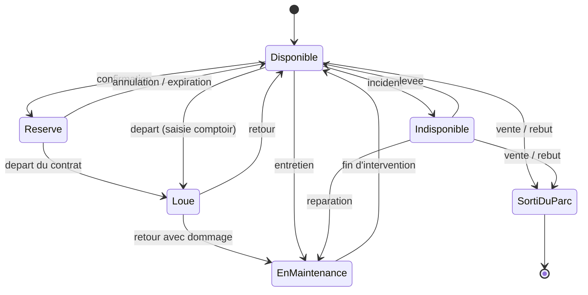

# Cahier des charges — Aviator, application de location de voitures (Laravel, MariaDB)

Version du 17/11/2026 — à valider par la direction d'Aviator et l'expert-comptable.

## 1. Présentation du projet

Le projet consiste à développer, avec Laravel et MariaDB 10.11, une application de gestion sur mesure pour Aviator, société tunisienne de location de voitures (20 à 50 véhicules, 4 agences, 6 utilisateurs, environ 1 000 clients). Elle couvre le parc, les réservations, les contrats, la facturation commerciale, les encaissements, les cautions, la maintenance, le leasing des véhicules, la relation client (CRM), des statistiques de rentabilité pour la prise de décision et, dans un second temps, un espace en ligne pour les clients. Toute l'application est utilisable sur smartphone et les notifications passent par des notifications push, sans SMS. **La comptabilité générale n'est pas incluse** : elle reste tenue par l'expert-comptable dans son propre logiciel, alimenté par des exports produits par l'application.

Ce document remplace, pour cette option technique, le cahier des charges ERPNext du 17/10/2026. Il doit être validé par la direction et l'expert-comptable avant tout développement.

### 1.1 Contexte

- **Société** : Aviator, location de voitures de courte et moyenne durée, en Tunisie.
- **Agences** : 4 agences — Djerba (siège), Sfax, Sousse et Tunis.
- **Parc** : environ 20 à 50 véhicules, achetés ou financés en leasing.
- **Utilisateurs** : 6 comptes — un super admin, un admin au siège de Djerba et un utilisateur par agence.
- **Clients** : environ 1 000 clients existants, à reprendre dans le CRM.
- **Socle technique** : application web Laravel, base MariaDB 10.11, hébergée en Tunisie (voir section 2).
- **Mode de réalisation** : développement assisté par IA (Claude Code), sous contrôle d'un responsable technique.
- **Évolutions envisagées** : vente de véhicules, gestion immobilière, prestations de services.

### 1.2 Objectifs

1. Centraliser, pour les 4 agences, la gestion du parc, des réservations, des contrats, de la facturation et des encaissements, avec un accès complet sur smartphone pour le super admin.
2. Supprimer les doubles réservations et les oublis de facturation grâce à des contrôles côté serveur.
3. Tracer chaque caution, de sa réception à sa restitution ou compensation.
4. Connaître, pour chaque véhicule, ses charges (leasing, apport, entretien, réparations, assurance), ses revenus et sa rentabilité, par mois et par année.
5. Offrir aux clients un espace en ligne pour réserver, payer et suivre leurs locations ; mieux connaître et fidéliser les quelque 1 000 clients grâce au CRM, et partager entre agences les recommandations sur les clients.
6. Protéger le carnet d'adresses des clients : consultation complète et export réservés au super admin.
7. Fournir à l'expert-comptable des exports fiables, dans le format qu'il aura validé.
8. Disposer d'une application maintenable par des développeurs PHP/Laravel, nombreux sur le marché tunisien.

### 1.3 Périmètre

| Inclus | Exclu |
| --- | --- |
| Paramétrage multi-agences, parc, réservations, contrats, états des lieux | Comptabilité générale : grand livre, balance, bilan, lettrage |
| Suivi du leasing et de l'apport initial par véhicule, échéanciers | Immobilisations et calcul comptable des amortissements |
| Facturation commerciale, avoirs, encaissements, relances | Déclarations fiscales (TVA, retenue à la source, etc.) |
| Cautions : réception, restitution, retenues | Paie et gestion du personnel |
| Maintenance, sinistres, dépenses par véhicule | Rapprochement bancaire |
| CRM : fiche client, historique, interactions, recommandations, segmentation | **Paiement en ligne** (reporté ; peut être ajouté plus tard) |
| Statistiques de décision : charges, revenus, rentabilité, utilisation, clients | **SMS** (aucun envoi de SMS) |
| **Interface responsive** : back-office utilisable sur smartphone et tablette | Applications mobiles à installer depuis les magasins d'applications (l'application web installable les remplace) |
| **Notifications push** aux utilisateurs et, au lot 2, aux clients | Vente de véhicules, immobilier, services (évolutions futures) |
| **Espace client en ligne (lot 2)** : compte, réservation, suivi, documents, factures, caution, réclamations | Conception graphique par une agence (charte graphique d'Aviator fournie ou à définir) |
| Exports pour l'expert-comptable ; administration, droits, journal d'audit |  |
| Reprise des données existantes (dont les \~1 000 clients), documentation, tests |  |

### 1.4 Découpage en deux lots

| Lot | Contenu | Quand |
| --- | --- | --- |
| Lot 1 — application de gestion | Modules A à K : parc, leasing, réservations, contrats, facturation, cautions, maintenance, exports, statistiques, CRM, administration, accès smartphone et notifications push | Dès le démarrage (phases 1 à 10) |
| Lot 2 — espace client | Module L, sans paiement en ligne | Dans un second temps, une fois le lot 1 en service (phase 11) |

Le lot 1 est conçu pour accueillir le lot 2 sans refonte : les règles de disponibilité, de tarification et de caution sont déjà dans des services partagés.

Les factures restent émises par l'application : leurs mentions obligatoires et taxes (TVA, timbre fiscal) sont appliquées selon des règles validées par l'expert-comptable.

### 1.5 Parties prenantes

| Partie prenante | Rôle dans le projet |
| --- | --- |
| Direction | Maître d'ouvrage, arbitre les priorités, valide les phases |
| Expert-comptable | Valide les mentions et taxes des factures et le format des exports |
| Conseil juridique (si besoin) | Valide le modèle de contrat et les conditions générales |
| Responsable technique | Pilote le développement assisté par IA, la qualité et le déploiement |
| Utilisateurs clés | Admin du siège et utilisateurs des 4 agences : expriment le besoin et réalisent la recette |
| Hébergeur (Oxahost, Tunis) | Fournit les serveurs de recette et de production |

## 2. Choix techniques

L'application est un monolithe Laravel 13 sur PHP 8.3, avec une base MariaDB 10.11, hébergé sur l'offre mutualisée **Oxahost Ultimate** à Tunis. Elle comprend le back-office responsive des 6 utilisateurs (lot 1) puis l'espace client (lot 2). L'hébergement mutualisé supprime l'administration système ; ses conditions sont détaillées en 2.2.

| Composant | Choix | Justification |
| --- | --- | --- |
| Framework | Laravel 13 | Version actuelle, sortie le 17/03/2026 ; corrections de sécurité jusqu'au 17/03/2028 ; montée de version annuelle prévue dans la maintenance |
| Langage | PHP 8.3 | Minimum exigé par Laravel 13 et version la plus récente proposée par Oxahost ; passage à PHP 8.4 dès qu'elle est disponible |
| Base de données | MariaDB 10.11 fourni par Oxahost (10.11.19), moteur InnoDB | Transactions et verrous de ligne nécessaires aux règles anti-chevauchement |
| Back-office | Filament v5 (sur Livewire), responsive | Écrans de gestion utilisables sur ordinateur, tablette et smartphone |
| Application installable | Application web installable (PWA) : icône sur l'écran d'accueil, plein écran | Accès du super admin depuis son téléphone, sans magasin d'applications |
| Notifications | Notifications push du navigateur (Web Push), paquet libre laravel-notification-channels/webpush | Gratuites, sans SMS ni prestataire payant ; sur iPhone, elles exigent iOS 16.4 ou plus et l'application ajoutée à l'écran d'accueil |
| Espace client (lot 2) | Pages Laravel (Blade et Livewire) avec Tailwind CSS, conçues d'abord pour le smartphone | Interface publique légère, aux couleurs d'Aviator, séparée du back-office |
| Droits d'accès | Policies Laravel + spatie/laravel-permission ; authentification séparée pour les clients | Les clients ne peuvent jamais accéder au back-office |
| Journal d'audit | spatie/laravel-activitylog | Historique des modifications et des opérations sensibles |
| Documents PDF | Génération HTML vers PDF en PHP, sans programme externe | Compatible avec un hébergement mutualisé |
| Tâches planifiées et files | Planificateur Laravel lancé par une tâche cron chaque minute ; file d'attente stockée en base | Pas de processus permanent sur un mutualisé |
| Tests | Pest ou PHPUnit, sur une base de test | Tests automatisés, y compris de concurrence |
| Hébergement | Oxahost Ultimate (mutualisé cPanel), Tunis | Données en Tunisie (loi 2004-63, art. 52), facturation en dinars, système administré par Oxahost |

### 2.1 Points d'attention

- **Une seule base de code** pour le back-office et l'espace client. La logique métier (disponibilité, tarification, cautions) est isolée dans des services partagés : une réservation en ligne passe exactement par les mêmes contrôles qu'une réservation au comptoir.
- **Aucune dépendance payante.** Toute bibliothèque sous licence commerciale doit être validée par le super admin avant d'être utilisée.

### 2.2 Conditions pour l'hébergement mutualisé

L'offre Ultimate convient à Aviator. La page des fonctionnalités d'Oxahost confirme l'essentiel ; quatre points restent à faire confirmer par écrit avant la commande.

| Point | Statut | Détail |
| --- | --- | --- |
| Espace disque | Confirmé | NVMe illimité ; 4 Go correspondent à la mémoire vive. Limite de 1 000 000 de fichiers (inodes), largement suffisante |
| Puissance | Confirmé | 4 vCores, 4 Go de RAM, 70 requêtes PHP simultanées, débit disque de 8 Mo/s |
| Accès SSH | Confirmé | Inclus dans l'offre Ultimate (absent des offres inférieures) |
| Base de données | Confirmé | MariaDB 10.11.19 (confirmé par Oxahost le 17/11/2026) |
| Sites | Confirmé | Sites illimités : production et recette en sous-domaine sur le même compte |
| Sauvegardes | Confirmé | Quotidiennes et à la demande (JetBackup), chiffrées, conservées jusqu'à 30 jours |
| Disponibilité | Confirmé | Engagement de 99,9 %, avec compensation ; support prioritaire |
| **Version de PHP** | **À confirmer** | La page indique PHP 5.6 à 8.3. PHP 8.3 suffit pour Laravel 13, mais il faut savoir quand PHP 8.4 sera proposé : les correctifs de sécurité de PHP 8.3 s'arrêtent fin 2027 |
| **Cron et Composer** | **À confirmer** | Tâche planifiée toutes les minutes et Composer utilisable en SSH |
| **Lieu des sauvegardes** | **À confirmer** | Stockées « sur des serveurs distants » : vérifier qu'ils sont en Tunisie ; ne pas activer l'option Acronis Cloud Europe |
| **Prix** | **À confirmer** | 29,90 DT HT par mois sur la page, soit 358,80 DT par an, mais 418,68 DT HT au récapitulatif de commande. Le chiffrage retient 418,68 DT |
| Envoi d'e-mails | Sans objet pour les notifications | 150 e-mails par heure : suffisant, les notifications passant par le push |

La garantie « satisfait ou remboursé » de 30 jours permet de vérifier ces points en installant le socle de l'application (phase 2) avant de s'engager pour l'année.

Sources : [Laravel, notes de version et politique de support](https://laravel.com/docs/13.x/releases.md) ; [MariaDB, dates de fin de support (endoflife.date)](https://endoflife.date/mariadb) ; [Filament v5](https://dev.to/hafiz619/filament-v5-released-whats-new-what-changed-and-should-you-upgrade-2h8l).

## 3. Acteurs et profils utilisateurs

Six comptes utilisent l'application, répartis en trois profils. Les droits sont contrôlés côté serveur, et chaque utilisateur d'agence n'agit que sur son agence. Les clients disposent en plus de leur propre espace en ligne (module L), totalement séparé du back-office.

| Profil | Comptes | Missions principales | Restrictions |
| --- | --- | --- | --- |
| Super admin | 1 (direction d'Aviator) | Pilotage global, statistiques, utilisateurs et droits, paramétrage, approbations (remises, retenues, liste noire), **seul accès au carnet d'adresses complet et aux exports de clients** | Aucune, mais toutes ses consultations et exports de données clients sont journalisés |
| Admin siège | 1 (Djerba) | Gestion des 4 agences : parc, leasing, maintenance, tarifs, facturation, encaissements, cautions, exports pour l'expert-comptable, statistiques | Pas d'accès au carnet d'adresses complet ni à l'export des clients ; pas de gestion des utilisateurs |
| Utilisateur d'agence | 4 (Djerba, Sfax, Sousse, Tunis) | Réservations, contrats, états des lieux, encaissements au comptoir, réception des cautions, création de clients, saisie d'interactions et de recommandations | Agit uniquement sur son agence ; voit la disponibilité des autres agences en lecture ; pas d'annulation de facture ; pas de remise au-delà du seuil ; accès client limité à la recherche (voir module K) |

| Profil externe | Comptes | Ce qu'il peut faire | Restrictions |
| --- | --- | --- | --- |
| Client | Un compte par client, créé par lui-même ou par une agence | Réserver, payer, suivre ses locations, factures et caution, gérer son profil et ses documents, faire une réclamation (module L) | Ne voit que ses propres données ; ne voit jamais les recommandations internes ni la liste noire ; aucun accès au back-office |

Le super admin utilise le back-office depuis son smartphone : tableau de bord, statistiques, approbations et recherche doivent y être pleinement utilisables (exigence J-09).

### 3.1 Qui voit quoi

| Donnée ou action | Super admin | Admin siège | Utilisateur d'agence |
| --- | --- | --- | --- |
| Carnet d'adresses complet (liste, coordonnées, export) | Oui | Non | Non |
| Recherche d'un client et fiche nécessaire au contrat | Oui | Oui | Oui |
| Recommandations sur un client (lecture, alerte) | Oui | Oui | Oui |
| Mise d'un client sur liste noire | Validation | Proposition | Proposition |
| Contrats, factures, encaissements | Toutes agences | Toutes agences | Son agence |
| Disponibilité des véhicules | Toutes agences | Toutes agences | Toutes agences, en lecture |
| Leasing, charges, rentabilité par véhicule | Oui | Oui | Non |
| Statistiques | Toutes | Toutes | Activité de son agence |
| Paramétrage, tarifs | Oui | Oui | Non |
| Utilisateurs et droits | Oui | Non | Non |
| Exports pour l'expert-comptable | Oui | Oui | Non |

L'expert-comptable n'est pas utilisateur de l'application : il reçoit les exports. Le seuil de remise des utilisateurs d'agence est à fixer par la direction (section 9).

## 4. Exigences fonctionnelles

Douze modules, de A à L. Priorités : **P1** indispensable au démarrage, **P2** important, **P3** souhaitable. Les priorités sont une proposition à valider par la direction. Tout est développé dans l'application : il n'y a plus de fonctions « natives » comme avec ERPNext.

### 4.1 Module A — Paramétrage

| ID | Exigence | P |
| --- | --- | --- |
| A-01 | Fiche société : raison sociale, matricule fiscal, adresse, devise (TND), logo, mentions légales des factures | P1 |
| A-02 | Les 4 agences (Djerba, siège ; Sfax ; Sousse ; Tunis) et leurs lieux de prise en charge et de restitution, avec horaires d'ouverture ; ajout d'agences possible sans développement | P1 |
| A-03 | Catégories de véhicules (ex. citadine, berline, SUV, utilitaire) | P1 |
| A-04 | Grilles tarifaires par catégorie, durée (jour, semaine, mois) et saison | P1 |
| A-05 | Options facturables : conducteur additionnel, siège enfant, GPS, livraison, franchise réduite | P1 |
| A-06 | Règles de réservation : durée minimale, préavis, tolérance de retard, délai d'expiration, délai de préparation entre deux locations | P1 |
| A-07 | Facturation : numérotation continue et sans trou par année, conditions de paiement, modes de paiement | P1 |
| A-08 | Taxes applicables aux factures (TVA, timbre fiscal), avec date d'effet, uniquement selon les règles validées par l'expert-comptable | P1 |
| A-09 | Notifications push : événements, destinataires et délais des alertes (assurance, visite technique, entretien, fin de leasing, retards, demandes d'approbation) ; aucun SMS | P2 |

Toute règle susceptible d'évoluer est un paramètre modifiable dans l'interface, jamais une valeur écrite dans le code.

### 4.2 Module B — Parc automobile

| ID | Exigence | P |
| --- | --- | --- |
| B-01 | Fiche véhicule : identifiant interne, immatriculation (unique), numéro de châssis (unique), marque, modèle, catégorie, année, couleur, carburant, boîte | P1 |
| B-02 | Acquisition : date, fournisseur, prix d'achat, mode de financement (comptant, crédit, leasing), apport initial (données de gestion, sans calcul comptable d'amortissement) | P1 |
| B-03 | Kilométrage mis à jour aux départs et retours ; baisse interdite sauf correction tracée | P1 |
| B-04 | Agence de rattachement et localisation actuelle | P1 |
| B-05 | Assurance (compagnie, police, échéance) et visite technique (date, échéance) | P1 |
| B-06 | Historique consolidé : contrats, maintenances, dépenses, sinistres | P1 |
| B-07 | Alertes avant échéances d'assurance, de visite technique et d'entretien | P1 |
| B-08 | Pièces jointes : carte grise, attestation d'assurance, photos | P2 |
| B-09 | Statut piloté par une machine à états (section 5) | P1 |
| B-10 | Sortie du parc (vente, mise au rebut) avec date et prix de cession, pour information | P2 |

#### Leasing et financement

| ID | Exigence | P |
| --- | --- | --- |
| B-11 | Contrat de leasing par véhicule : société de leasing, référence, dates de début et de fin, apport initial (premier loyer majoré), loyer mensuel HT et TTC, valeur résiduelle, option d'achat | P1 |
| B-12 | Échéancier des loyers généré automatiquement, avec pointage des loyers payés | P1 |
| B-13 | Alertes avant la fin du leasing et la date de levée d'option | P1 |
| B-14 | Fin de leasing : levée d'option (le véhicule devient propriété) ou restitution (sortie du parc) | P2 |
| B-15 | Crédit bancaire (si utilisé) : montant, durée, mensualités, échéancier | P2 |

Les loyers, l'apport et les mensualités alimentent les charges par véhicule du module I.

### 4.3 Module C — Réservations

| ID | Exigence | P |
| --- | --- | --- |
| C-01 | Recherche des véhicules disponibles par période, agence et catégorie | P1 |
| C-02 | Planning visuel des réservations et contrats par véhicule (vue calendrier ou frise) | P1 |
| C-03 | Création, modification, annulation avec motif obligatoire | P1 |
| C-04 | Dates et heures de départ et de retour, agences de départ et de retour | P1 |
| C-05 | Réservation par catégorie ou véhicule précis ; affectation au plus tard au départ | P1 |
| C-06 | Estimation du prix (grille, options, remises) | P1 |
| C-07 | Blocage côté serveur de tout chevauchement sur un même véhicule, y compris en saisies simultanées | P1 |
| C-08 | Statuts : brouillon, confirmée, annulée, expirée, convertie en contrat | P1 |
| C-09 | Expiration automatique des réservations non confirmées | P2 |
| C-10 | Acompte enregistré à la réservation | P2 |

### 4.4 Module D — Contrats de location

| ID | Exigence | P |
| --- | --- | --- |
| D-01 | Contrat créé à partir d'une réservation confirmée ou au comptoir | P1 |
| D-02 | Fiche client (particulier ou entreprise) et conducteurs autorisés : pièce d'identité, permis, dates | P1 |
| D-03 | Refus d'un conducteur au permis expiré ou trop récent selon l'ancienneté paramétrée | P1 |
| D-04 | Tarif et options ; remise au-delà du seuil soumise à l'approbation du super admin | P1 |
| D-05 | Conditions de kilométrage (illimité ou forfait et prix du km supplémentaire) et de carburant | P1 |
| D-06 | États des lieux au départ et au retour : kilométrage, carburant, dommages sur schéma, photos, signature sur tablette | P1 |
| D-07 | Prolongation après contrôle de disponibilité sur la nouvelle période | P1 |
| D-08 | Restitution anticipée selon la règle de remboursement validée | P2 |
| D-09 | Calcul des frais : retard, km supplémentaires, carburant manquant, dommages | P1 |
| D-10 | Impression du contrat, de l'état des lieux et des conditions générales en PDF | P1 |
| D-11 | Contrat clôturé non modifiable ; correction par avenant ou facture complémentaire | P1 |

### 4.5 Module E — Facturation et encaissements

| ID | Exigence | P |
| --- | --- | --- |
| E-01 | Facture générée depuis le contrat : location, options, frais, taxes | P1 |
| E-02 | Aucune facturation en double d'une même période d'un même contrat | P1 |
| E-03 | Numérotation chronologique continue ; une facture validée n'est jamais modifiée ni supprimée | P1 |
| E-04 | Avoirs total ou partiel, liés à la facture d'origine | P1 |
| E-05 | Factures complémentaires (retard, dommages, km supplémentaires) | P1 |
| E-06 | Encaissements : espèces, chèque, carte, virement, traite ; paiements partiels et acomptes imputés | P1 |
| E-07 | Suivi des factures impayées et de leur ancienneté | P1 |
| E-08 | Relances avec historique | P2 |
| E-09 | Journal de caisse par agence et par jour, avec clôture | P2 |
| E-10 | Envoi des factures par e-mail en PDF | P2 |

### 4.6 Module F — Cautions

| ID | Exigence | P |
| --- | --- | --- |
| F-01 | Caution liée à un contrat : montant, mode (espèces, chèque, empreinte de carte, virement), date, référence | P1 |
| F-02 | États : reçue, à restituer, restituée, partiellement compensée | P1 |
| F-03 | Restitution totale ou partielle avec reçu imprimable | P1 |
| F-04 | Retenue documentée : motif, montant, justificatif, lien vers la facture de frais | P1 |
| F-05 | Retenue soumise à l'approbation du super admin | P1 |
| F-06 | Restitué + retenu ≤ reçu ; double restitution impossible | P1 |
| F-07 | Les cautions n'apparaissent jamais dans le chiffre d'affaires ; elles sont exportées à part | P1 |
| F-08 | Liste des cautions en cours et de leur ancienneté | P2 |

### 4.7 Module G — Maintenance, sinistres et dépenses

| ID | Exigence | P |
| --- | --- | --- |
| G-01 | Entretiens préventifs planifiés par kilométrage ou par date | P1 |
| G-02 | Ordres de réparation et contrôles techniques, avec fournisseur, montant et pièce justificative | P1 |
| G-03 | Véhicule passé en maintenance pendant l'intervention et non réservable | P1 |
| G-04 | Dépenses par véhicule : réparations, pièces, assurance, vignette, carburant selon périmètre | P1 |
| G-05 | Fournisseurs : fiche simple (nom, matricule fiscal, contact) | P1 |
| G-06 | Sinistres : date, circonstances, constat, tiers, assureur, montants estimé et indemnisé | P2 |
| G-07 | Périodes d'immobilisation et leur motif | P2 |
| G-08 | Rapports : coût total par véhicule, dépenses par période et par nature, jours d'immobilisation | P1 |

Les dépenses servent au suivi de gestion. Leur comptabilisation reste faite par l'expert-comptable à partir des exports.

### 4.8 Module H — Exports pour l'expert-comptable

Ce module remplace la comptabilité intégrée. Le format exact (colonnes, codes, comptes éventuels) est fixé avec l'expert-comptable avant la phase 8.

| ID | Exigence | P |
| --- | --- | --- |
| H-01 | Journal des ventes par période : factures et avoirs, avec numéro, date, client, matricule fiscal, montants HT, taxes par taux, TTC | P1 |
| H-02 | Journal des encaissements par période et par mode de paiement | P1 |
| H-03 | État des cautions : reçues, restituées, retenues, en cours | P1 |
| H-04 | Journal des dépenses par véhicule, fournisseur et nature | P1 |
| H-05 | Exports en Excel et en CSV, au format validé par l'expert-comptable | P1 |
| H-06 | Clôture d'une période exportée : plus aucune facture ni encaissement ne peut y être ajouté ou modifié | P1 |
| H-07 | Correspondance avec les comptes du plan comptable de l'expert-comptable (si demandée) | P2 |
| H-08 | Export au format d'import du logiciel de l'expert-comptable (si demandé) | P3 |

### 4.9 Module I — Statistiques et tableau de bord

Les statistiques doivent permettre à la direction de décider : quels véhicules garder, vendre ou remplacer, quelles agences développer, quels tarifs ajuster, quels clients fidéliser. Chaque indicateur est filtrable par **mois, année, agence, catégorie et véhicule**, comparable à la même période de l'année précédente, et exportable en Excel. Sa formule, sa source et ses limites sont documentées. La rentabilité est une estimation de gestion, pas un résultat comptable.

#### Charges par véhicule

| ID | Indicateur | Contenu |
| --- | --- | --- |
| I-01 | Charges par véhicule, par mois et par année | Total et détail par nature : loyers de leasing, mensualités de crédit, entretiens, réparations, pneus, assurance, vignette, visite technique, sinistres non couverts, autres |
| I-02 | Apport initial par véhicule | Apport versé à l'acquisition ou au leasing, et sa part répartie sur la durée de détention (méthode à valider) |
| I-03 | Suivi du leasing | Loyers payés et restants, date de fin, valeur résiduelle, total des engagements par mois à venir |
| I-04 | Entretiens | Nombre et coût par véhicule, intervalle moyen, entretiens en retard |
| I-05 | Coût au kilomètre | Charges totales ÷ kilomètres parcourus sur la période |

#### Revenus et rentabilité

| ID | Indicateur | Contenu |
| --- | --- | --- |
| I-06 | Chiffre d'affaires | Par mois, année, agence, catégorie et véhicule ; HT, net des avoirs |
| I-07 | Marge par véhicule | CA HT − charges du véhicule, par mois et cumulée sur l'année |
| I-08 | Rentabilité par véhicule | Marge ÷ coût total engagé (apport, loyers, mensualités, charges) ; classement des véhicules du plus au moins rentable |
| I-09 | Point mort | Nombre de jours de location par mois nécessaires pour couvrir les charges du véhicule |
| I-10 | Alerte « véhicule à revoir » | Véhicule dont la marge est négative ou dont les réparations dépassent un seuil paramétré sur 12 mois |

#### Activité du parc et des agences

| ID | Indicateur | Contenu |
| --- | --- | --- |
| I-11 | Taux d'utilisation | Jours loués ÷ jours disponibles, par véhicule, catégorie et agence |
| I-12 | Revenu par jour disponible | CA HT ÷ jours où le véhicule était louable : combine prix et taux d'occupation |
| I-13 | Prix moyen par jour et durée moyenne de location | Par catégorie, agence et saison, pour ajuster les tarifs |
| I-14 | Comparaison des 4 agences | CA, marge, utilisation, nombre de contrats, impayés |
| I-15 | Immobilisation | Jours d'indisponibilité par véhicule et par motif (entretien, réparation, sinistre) |
| I-16 | Âge et kilométrage du parc | Âge moyen, kilométrage moyen, véhicules proches du seuil de renouvellement |
| I-17 | Réservations | Taux de conversion en contrat, taux d'annulation, délai moyen de réservation |

#### Clients et risques

| ID | Indicateur | Contenu |
| --- | --- | --- |
| I-18 | Clients | Nouveaux clients, clients actifs, taux de clients qui reviennent, répartition particuliers / entreprises |
| I-19 | Meilleurs clients | Classement par CA et nombre de locations sur 12 mois |
| I-20 | Impayés | Montant et nombre par ancienneté, par agence |
| I-21 | Cautions et sinistres | Retenues sur caution, nombre et coût des sinistres, part non couverte |
| I-22 | Retards et échéances | Restitutions en retard ; assurances, visites, entretiens et fins de leasing à venir |

Le tableau de bord d'accueil du super admin et de l'admin présente les indicateurs clés du mois ; celui d'un utilisateur d'agence, l'activité de son agence (départs, retours, retards du jour).

### 4.10 Module J — Administration et sécurité

Ce module est nécessaire avec Laravel : ERPNext le fournissait d'origine.

| ID | Exigence | P |
| --- | --- | --- |
| J-01 | Gestion des utilisateurs : création, désactivation, réinitialisation du mot de passe | P1 |
| J-02 | Rôles et permissions par profil et rattachement de chaque utilisateur à son agence (section 3), gérés par le super admin | P1 |
| J-03 | Authentification à deux facteurs obligatoire pour le super admin et l'admin du siège | P1 |
| J-04 | Journal d'audit des opérations sensibles : annulations, remises, retenues, tarifs, droits, corrections de kilométrage | P1 |
| J-05 | Historique des modifications sur les documents métier (qui, quand, avant, après) | P1 |
| J-06 | Interface en français ; documents clients en français, arabe à confirmer | P1 |
| J-07 | Import initial des données (véhicules, clients, contrats en cours) depuis Excel | P1 |
| J-08 | Sauvegarde et restauration documentées, déclenchables par l'administrateur | P2 |

| ID | Exigence d'accès mobile et de notification | P |
| --- | --- | --- |
| J-09 | Back-office responsive : tableau de bord, statistiques (graphiques lisibles sur petit écran), approbations (remises, retenues, liste noire, dérogations), recherche de clients et de véhicules pleinement utilisables sur smartphone par le super admin | P1 |
| J-10 | Saisie au comptoir et état des lieux utilisables sur tablette, avec prise de photos et signature | P1 |
| J-11 | Application web installable sur l'écran d'accueil du téléphone (Android et iPhone), sans magasin d'applications | P1 |
| J-12 | Notifications push, seul canal de notification : demandes d'approbation au super admin ; échéances, retards de restitution, réservations du jour et alertes de recommandation aux agences | P1 |
| J-13 | Préférences de notification par utilisateur (types d'alertes reçus) et centre de notifications dans l'application, pour retrouver une notification manquée | P1 |
| J-14 | Aucune donnée sensible dans le texte d'une notification (pas de montant détaillé, pas de motif de liste noire) : le détail s'affiche après connexion | P1 |

Les e-mails ne servent qu'à la sécurité des comptes (réinitialisation du mot de passe, vérification d'adresse). Sur iPhone, les notifications push exigent iOS 16.4 ou plus et l'application ajoutée à l'écran d'accueil.

### 4.11 Module K — Relation client (CRM)

Le CRM centralise les quelque 1 000 clients d'Aviator pour les 4 agences. Le carnet d'adresses complet est réservé au super admin ; les agences n'accèdent aux clients que par la recherche.

#### Fiche et carnet d'adresses

| ID | Exigence | P |
| --- | --- | --- |
| K-01 | Fiche client complète : identité, type (particulier ou entreprise), matricule fiscal, coordonnées, pièces, permis, conducteurs associés, agence d'origine, source d'acquisition | P1 |
| K-02 | Vue d'ensemble du client : historique des réservations et contrats, factures, impayés, cautions, sinistres, interactions, recommandations | P1 |
| K-03 | **Carnet d'adresses complet** (liste de tous les clients avec coordonnées, filtres, export) **accessible uniquement au super admin** ; chaque consultation et chaque export sont journalisés | P1 |
| K-04 | Utilisateurs d'agence et admin : recherche d'un client par numéro de pièce, permis, téléphone ou nom exact ; affichage limité aux informations nécessaires au contrat ; aucune liste complète, aucun export | P1 |
| K-05 | Création d'un client au comptoir, avec détection des doublons (même pièce, permis ou téléphone) | P1 |
| K-06 | Import des \~1 000 clients existants depuis Excel, avec rapport des doublons et anomalies | P1 |
| K-07 | Consentement du client à recevoir des messages commerciaux, enregistré avec sa date | P1 |

#### Recommandations sur les clients

| ID | Exigence | P |
| --- | --- | --- |
| K-08 | Recommandation interne sur chaque client : niveau (recommandé, standard, vigilance, liste noire), motif factuel, date, auteur, contrat concerné | P1 |
| K-09 | Saisie d'une recommandation par tout utilisateur après une location ; historique conservé, aucune suppression | P1 |
| K-10 | Alerte automatique à la recherche, à la réservation et au contrat quand le client est en « vigilance » ou sur liste noire, dans toutes les agences | P1 |
| K-11 | Mise sur liste noire proposée par une agence et validée par le super admin ; une réservation pour un client sur liste noire exige une dérogation du super admin | P1 |
| K-12 | Avantages possibles pour les clients recommandés : remise ou caution réduite, selon des règles paramétrées | P2 |
| K-13 | Parrainage : client apporteur enregistré sur la fiche du nouveau client | P3 |

#### Suivi de la relation

| ID | Exigence | P |
| --- | --- | --- |
| K-14 | Journal des interactions : appels, e-mails, visites, réclamations, litiges, avec suite donnée | P1 |
| K-15 | Réclamations : enregistrement, responsable, statut, délai de traitement | P2 |
| K-16 | Segmentation : particuliers, entreprises, fidèles, inactifs depuis X mois, meilleurs clients | P2 |
| K-17 | Rappels de suivi (relancer un client inactif, proposer un renouvellement à une entreprise) | P2 |
| K-18 | Notifications push groupées aux clients consentants d'un segment (dès le lot 2), par le super admin uniquement ; aucun SMS | P3 |

Les recommandations et la liste noire sont des données personnelles : motifs uniquement factuels, durée de conservation limitée, et droit d'accès du client. Leur cadre est à valider avec le conseil juridique avant la phase 7 (section 9).

### 4.12 Module L — Espace client en ligne (lot 2)

L'espace client est livré dans un second temps (lot 2). Il permet à un client de faire en ligne tout ce qu'il peut faire avec Aviator, **sauf payer** : le paiement en ligne est reporté, les règlements se font en agence. Il est conçu d'abord pour le smartphone, aux couleurs d'Aviator, et utilise les mêmes règles que le comptoir (disponibilité, tarifs, cautions).

#### Compte et profil

| ID | Exigence | P |
| --- | --- | --- |
| L-01 | Création de compte par e-mail ou téléphone, vérification de l'adresse e-mail, mot de passe oublié | P1 |
| L-02 | Rattachement automatique à la fiche existante si le client est déjà connu d'une agence (par pièce d'identité ou permis), après vérification | P1 |
| L-03 | Profil : coordonnées, conducteurs supplémentaires, préférences de contact, consentement aux messages commerciaux | P1 |
| L-04 | Envoi de la pièce d'identité et du permis (photo), vérifiés par l'agence avant le départ | P1 |
| L-05 | Consultation et téléchargement de ses données personnelles ; demande de suppression du compte (droit d'accès, loi 2004-63) | P2 |

#### Réservation en ligne

| ID | Exigence | P |
| --- | --- | --- |
| L-06 | Présentation des catégories de véhicules avec photos, équipements, prix indicatifs et conditions, par agence | P1 |
| L-07 | Recherche par agence de départ et de retour, dates et heures ; affichage des seules catégories disponibles | P1 |
| L-08 | Devis immédiat : prix de la location, options, caution demandée, conditions d'annulation | P1 |
| L-09 | Réservation en ligne sans paiement, avec confirmation immédiate ou après validation de l'agence, selon un paramètre ; règlement à l'agence au départ | P1 |
| L-10 | Paiement en ligne : **hors périmètre pour l'instant** ; l'architecture permet de l'ajouter plus tard avec une passerelle tunisienne | — |
| L-11 | Modification et annulation par le client dans les délais et conditions paramétrés ; au-delà, demande transmise à l'agence | P1 |
| L-12 | Contrôle invisible des recommandations : un client en vigilance ou sur liste noire ne peut pas réserver en ligne ; il est invité à contacter l'agence, sans que le motif soit affiché | P1 |

#### Suivi des locations

| ID | Exigence | P |
| --- | --- | --- |
| L-13 | Mes réservations et mes locations : à venir, en cours, passées, avec agence, véhicule et dates | P1 |
| L-14 | Location en cours : contrat et état des lieux de départ en PDF, date de retour, coordonnées de l'agence | P1 |
| L-15 | Demande de prolongation depuis l'espace client, acceptée si le véhicule est disponible ; le complément est réglé en agence | P1 |
| L-16 | Mes factures : liste, statut (payée, à payer), téléchargement en PDF | P1 |
| L-17 | Ma caution : montant, mode, statut, restitution et retenues éventuelles avec leur justificatif | P1 |

#### Relation avec Aviator

| ID | Exigence | P |
| --- | --- | --- |
| L-18 | Messages et réclamations : envoi, suivi du statut et des réponses ; ils alimentent le journal des interactions du CRM | P1 |
| L-19 | Avis après location (note et commentaire), distinct des recommandations internes | P2 |
| L-20 | Notifications push au client (s'il les accepte) : confirmation de réservation, rappel la veille du départ, rappel de retour, facture disponible, restitution de caution ; tout reste consultable dans l'espace client | P1 |
| L-21 | Avantages de fidélité visibles par le client (remises, caution réduite) si les règles K-12 sont activées | P3 |
| L-22 | Parrainage : lien à partager pour recommander Aviator à un proche (lié à K-13) | P3 |
| L-23 | Pages publiques : conditions générales de location et de réservation en ligne, politique de confidentialité, agences et horaires, contact | P1 |
| L-24 | Espace client en français ; anglais et arabe selon la réponse à la question Q5 (clientèle touristique à Djerba notamment) | P1 |

## 5. Règles de gestion et modèle de données

Le cycle central est : réservation → contrat → facture → encaissement, avec la caution suivie à part. Toutes les règles ci-dessous sont contrôlées côté serveur, dans des transactions MariaDB (InnoDB).

### 5.1 Statuts du véhicule

Tout passe par « Disponible », sauf le départ d'une réservation et le passage en maintenance au retour. « Sorti du parc » est définitif. Le statut est dérivé des opérations, jamais saisi à la main ; un véhicule dont l'assurance ou la visite technique est expirée ne peut pas partir en location.

### 5.2 Règles de gestion

| ID | Règle | Mise en œuvre attendue |
| --- | --- | --- |
| RG-01 | Pas de chevauchement de réservations ou contrats actifs sur un véhicule, délai de préparation compris | Requête d'intersection de périodes dans un service unique de disponibilité |
| RG-02 | Contrôle robuste aux saisies simultanées | Transaction InnoDB avec verrou de ligne sur le véhicule (`SELECT … FOR UPDATE`) ; test de concurrence obligatoire |
| RG-03 | Contrat issu d'une réservation confirmée ou d'une saisie comptoir avec contrôle immédiat | Même service de disponibilité |
| RG-04 | Kilométrage de retour ≥ kilométrage de départ | Validation de l'état des lieux |
| RG-05 | Une période facturée d'un contrat ne l'est pas deux fois | Contrôle à la validation de la facture |
| RG-06 | Facture validée jamais modifiée ni supprimée ; correction par avoir | Statut verrouillé, suppression interdite en base et dans l'interface |
| RG-07 | Numérotation des factures continue, chronologique, sans trou | Compteur par année attribué dans une transaction à la validation, jamais au brouillon |
| RG-08 | Restitué + retenu ≤ montant de caution reçu | Verrou de ligne sur la caution et recalcul serveur |
| RG-09 | Retards facturés au-delà de la tolérance, selon l'unité paramétrée | Service de tarification |
| RG-10 | Remise au-delà du seuil soumise à l'approbation du super admin | Statut « en attente d'approbation » et contrôle serveur |
| RG-11 | Documents validés annulés, jamais supprimés ; historique conservé | Suppression logique interdite sur les documents validés ; journal d'audit |
| RG-12 | Période exportée et clôturée non modifiable | Contrôle de date sur factures, avoirs et encaissements |

| ID | Règle ajoutée pour Aviator | Mise en œuvre attendue |
| --- | --- | --- |
| RG-13 | Un utilisateur d'agence ne crée et ne modifie que les documents de son agence | Portée par agence appliquée dans les requêtes et les policies, testée pour chaque type de document |
| RG-14 | Le carnet d'adresses complet et tout export de clients sont réservés au super admin | Contrôle serveur ; chaque consultation et export inscrit au journal d'audit |
| RG-15 | Un client sur liste noire ne peut pas recevoir de réservation ni de contrat sans dérogation du super admin | Contrôle dans le service de réservation ; dérogation tracée |
| RG-16 | Une recommandation n'est jamais supprimée ; elle est remplacée par une nouvelle | Historique en ajout seul |
| RG-17 | Les charges d'un véhicule sont rattachées à un mois : un loyer de leasing ou une dépense n'est compté qu'une fois | Date d'imputation obligatoire ; contrôle des doublons |
| RG-18 | Une réservation en ligne (lot 2) passe par le même service de disponibilité et de tarification qu'au comptoir | Aucun calcul de prix ni de disponibilité dans l'interface ; tout est recalculé côté serveur |
| RG-19 | Un client connecté ne voit et ne modifie que ses propres réservations, factures, cautions et documents | Contrôle d'appartenance sur chaque requête de l'espace client |
| RG-20 | Une notification push n'est envoyée qu'aux appareils de son destinataire et ne contient aucune donnée sensible | Abonnements liés au compte ; texte générique, détail après connexion |
| RG-21 | Une réservation en ligne en attente de validation par l'agence expire après un délai paramétré | Tâche planifiée d'expiration ; le client est notifié |

### 5.3 Tables principales

| Table | Rôle | Liens clés |
| --- | --- | --- |
| `settings`, `taxes` | Paramètres métier, taxes avec date d'effet | — |
| `agencies` | Agences et lieux | — |
| `vehicle_categories`, `rate_plans`, `rate_plan_lines`, `options` | Catégories, grilles tarifaires, options | Grille → catégorie |
| `vehicles`, `vehicle_status_logs` | Parc et historique des statuts | Véhicule → catégorie, agence |
| `customers`, `drivers` | Clients et conducteurs autorisés | Conducteur → client |
| `reservations` | Réservations | → client, catégorie, véhicule, agences |
| `contracts`, `contract_drivers`, `contract_options` | Contrats | → réservation, véhicule, client |
| `inspections`, `inspection_damages`, `inspection_photos` | États des lieux départ et retour | → contrat |
| `invoices`, `invoice_lines`, `invoice_taxes` | Factures et avoirs | → contrat, client ; avoir → facture d'origine |
| `payments`, `payment_allocations` | Encaissements et imputation | → client, factures |
| `deposits`, `deposit_movements` | Cautions et mouvements | → contrat, facture de frais |
| `maintenance_orders`, `expenses`, `suppliers`, `incidents` | Maintenance, dépenses, sinistres | → véhicule, fournisseur |
| `export_periods` | Périodes exportées et clôturées | — |
| `users`, `roles`, `permissions`, `activity_log` | Utilisateurs, droits, audit | Tables des paquets Spatie |

| Table ajoutée pour Aviator | Rôle | Liens clés |
| --- | --- | --- |
| `vehicle_financings`, `financing_installments` | Leasing ou crédit, apport initial, échéancier des loyers | → véhicule |
| `customer_recommendations` | Recommandations et liste noire, en ajout seul | → client, utilisateur, contrat |
| `customer_interactions`, `complaints` | Journal des interactions et réclamations (y compris celles envoyées depuis l'espace client) | → client, utilisateur |
| `customer_segments`, `customer_consents` | Segments et consentements commerciaux | → client |
| `push_subscriptions`, `notifications` | Appareils abonnés aux notifications push et historique des notifications | → utilisateur ou client |
| `customer_accounts` (lot 2) | Comptes de l'espace client (identifiants, vérification, dernière connexion) | → client (1 pour 1) |
| `customer_documents` (lot 2) | Pièces envoyées par les clients et leur statut de vérification | → client |
| `reviews` (lot 2) | Avis des clients après location | → client, contrat |
| `kpi_monthly_vehicle` | Agrégats mensuels par véhicule (charges, CA, jours loués), recalculés chaque nuit pour des statistiques rapides | → véhicule, agence |

Toutes les tables métier portent l'agence (`agency_id`) quand la donnée lui appartient.

Montants stockés en `DECIMAL(15,3)` : le dinar compte trois décimales (millimes). Le modèle détaillé (colonnes, index, contraintes) est livré en phase 2.

## 6. Exigences non fonctionnelles

L'application doit être sûre, maintenable par un développeur Laravel autre que l'auteur initial, et hébergée en Tunisie.

### 6.1 Architecture et qualité du code

- Logique métier dans des services dédiés (disponibilité, tarification, facturation, cautions), testés indépendamment de l'interface.
- Migrations de base versionnées et réversibles ; aucune modification manuelle du schéma en production.
- Code versionné sous Git, une branche par phase, revue avant fusion.
- Analyse statique et formatage automatiques (PHPStan ou Larastan, Laravel Pint) dans l'intégration continue.
- Couverture de tests : 100 % des règles RG-01 à RG-12 et des scénarios de recette ; objectif global de 70 % sur les services métier.
- Paramètres métier en base, secrets dans le fichier d'environnement, jamais dans le code ni dans Git.

### 6.2 Sécurité

- Autorisations vérifiées côté serveur sur chaque action (policies) ; masquer un bouton ne suffit pas.
- Protection contre les failles courantes : injection SQL (requêtes paramétrées), XSS, CSRF, envoi de fichiers malveillants.
- Mots de passe hachés ; authentification à deux facteurs pour les profils sensibles ; verrouillage après échecs répétés.
- Pièces d'identité, permis et photos stockés hors du dossier public, servis uniquement aux utilisateurs autorisés.
- HTTPS obligatoire ; en-têtes de sécurité ; dépendances vérifiées (`composer audit`) à chaque livraison.

Pour l'espace client, ouvert sur Internet :

- Authentification des clients séparée de celle des utilisateurs ; un client ne peut accéder qu'à ses propres données, contrôlé sur chaque requête.
- Limitation du nombre de tentatives de connexion et de créations de compte ; protection anti-robots sur les formulaires publics.
- Aucune donnée bancaire traitée : il n'y a pas de paiement en ligne dans ce périmètre.
- Pièces envoyées par les clients contrôlées (type, taille) et stockées hors du dossier public.

### 6.3 Données personnelles

- Données hébergées exclusivement en Tunisie, sauvegardes comprises : aucun transfert à l'étranger (loi organique 2004-63, art. 52).
- Déclaration préalable du traitement auprès de l'INPDP par la société (art. 7).
- Durée de conservation des pièces d'identité à fixer avec le conseil juridique, puis purge automatique.

### 6.4 Performance et ergonomie

- 6 utilisateurs répartis sur 4 agences, environ 1 000 clients, plusieurs milliers de contrats par an ; conçu pour croître jusqu'à 10 agences et 10 000 clients sans refonte.
- Recherche de disponibilité, planning et statistiques affichés en moins de 3 secondes pour 50 véhicules et 3 ans d'historique.
- Back-office et espace client responsive : utilisables sur ordinateur, tablette et smartphone, testés sur les navigateurs courants d'Android et d'iPhone ; temps d'affichage d'une page de l'espace client inférieur à 3 secondes sur une connexion mobile 4G.
- Interface en français ; documents clients en arabe à confirmer (impose une mise en page de droite à gauche dans les PDF).

### 6.5 Hébergement, sauvegardes et déploiement

| Environnement | Où | Usage |
| --- | --- | --- |
| Développement | Poste du développeur : Windows 11 avec Laragon (PHP 8.3.16, MariaDB 10.11) | Développement et tests automatisés |
| Recette | Sous-domaine du compte Oxahost Ultimate (par exemple `recette.aviator.tn`), base séparée, accès protégé par mot de passe | Essais des utilisateurs, validation des phases |
| Production | Compte Oxahost Ultimate, Tunis : back-office et espace client | Exploitation |

- Le système (serveur web, PHP, base de données, sécurité du serveur) est administré par Oxahost : il n'y a plus d'administration système à la charge d'Aviator, seulement un suivi (version de PHP, sauvegardes, espace disque).
- Déploiement automatisé depuis Git par SSH, avec mise en maintenance et migrations de base ; jamais de copie manuelle des fichiers.
- Sauvegardes : celles d'Oxahost, plus une copie mensuelle de la base et des fichiers conservée par Aviator en Tunisie ; restauration testée sur la recette chaque trimestre.
- Alerte quand l'espace disque dépasse 80 % ; photos compressées à l'envoi.
- Aucun déploiement en production sans sauvegarde vérifiée, tests réussis et autorisation explicite ; procédure de retour arrière documentée.

## 7. Phasage, recette et livrables

Le projet avance en onze phases : dix pour le lot 1 (245 jours), puis une pour le lot 2 (45 jours). Chaque phase se termine par une validation formelle avant d'ouvrir la suivante.

### 7.1 Phases

| Phase | Lot | Contenu | Charge (j) | Critère d'acceptation principal | Validation |
| --- | --- | --- | --- | --- | --- |
| 1. Analyse et maquettes | 1 | Ateliers avec les 4 agences, parcours, maquettes du comptoir, du planning, du CRM et des statistiques sur smartphone | 12 | Maquettes et questions ouvertes validées | Super admin |
| 2. Architecture et socle | 1 | Modèle de données, authentification, profils, portée par agence, audit, déploiement sur le mutualisé | 19 | Socle déployé en recette ; points « à confirmer » de la section 2.2 vérifiés dans les 30 jours de garantie | Responsable technique |
| 3. Paramétrage et référentiels | 1 | Module A (4 agences), conducteurs, fournisseurs | 16 | Paramétrage complet saisi en recette | Admin siège |
| 4. Parc, leasing et réservations | 1 | Modules B et C, planning, alertes | 39 | Aucune double réservation possible ; échéanciers de leasing justes | Admin siège, agences |
| 5. Contrats et états des lieux | 1 | Module D, impressions, tablette | 30 | Cycle réservation → départ → retour complet | Agences |
| 6. Facturation, encaissements, cautions | 1 | Modules E et F | 31 | Factures conformes aux règles validées ; cautions tracées | Admin siège, expert-comptable |
| 7. CRM et recommandations | 1 | Module K, import des \~1 000 clients | 21 | Carnet réservé au super admin ; alertes de recommandation dans toutes les agences | Super admin |
| 8. Maintenance, dépenses, exports | 1 | Modules G et H | 20 | Exports acceptés par l'expert-comptable sur un mois de test | Expert-comptable |
| 9. Statistiques, mobile et sécurité | 1 | Modules I et J : statistiques, back-office sur smartphone, application installable, notifications push, revue de sécurité | 38 | Approbations et statistiques utilisées depuis un smartphone ; notifications reçues sur Android et iPhone | Super admin |
| 10. Recette et mise en production du lot 1 | 1 | Reprise des données, formation des 6 utilisateurs, bascule | 19 | Recette signée, sauvegarde et restauration testées | Super admin |
| 11. Espace client | 2 | Module L sans paiement en ligne, pages publiques, notifications push aux clients, mise en ligne | 45 | Parcours complet sur smartphone : compte, réservation, suivi, facture, caution | Super admin |

### 7.2 Scénarios de recette obligatoires

1. Deux réservations simultanées sur le même véhicule et la même période : une seule aboutit.
2. Réservation annulée : le véhicule redevient disponible.
3. Contrat prolongé avec contrôle de disponibilité.
4. Restitution en retard : frais calculés selon les paramètres.
5. Facture réglée en deux paiements partiels.
6. Caution partiellement restituée après retenue approuvée.
7. Avoir partiel sur une facture validée ; numérotation sans trou.
8. Tentative de modification d'une facture validée ou d'une période clôturée : refus.
9. Export d'un mois complet, rapproché à l'identique des factures, avoirs et encaissements.
10. Véhicule à l'assurance expirée : départ refusé.
11. Utilisateur non autorisé tentant une opération sensible : refus côté serveur.

Scénarios ajoutés pour Aviator :

12. L'utilisateur de Sfax tente de modifier un contrat de Sousse : refus.
13. L'admin du siège ou un utilisateur d'agence tente d'ouvrir le carnet d'adresses complet ou d'exporter les clients : refus, tentative journalisée.
14. Client mis sur liste noire à Tunis : alerte à Djerba dès la recherche, réservation bloquée sans dérogation du super admin.
15. Véhicule en leasing : les loyers du mois apparaissent une seule fois dans ses charges et dans sa rentabilité.
16. Rentabilité d'un véhicule sur un mois, recalculée à la main à partir des factures et dépenses : résultat identique.

Scénarios ajoutés pour l'espace client et le mobile :

17. Lot 2 : un client réserve en ligne pendant qu'une agence réserve le même véhicule au comptoir : une seule réservation aboutit.
18. Lot 2 : un client connecté modifie l'adresse d'une page pour ouvrir la facture d'un autre client : refus.
19. Une demande de remise déclenche une notification push sur le smartphone du super admin, qui l'approuve depuis son téléphone ; le texte de la notification ne contient aucun montant.
20. Lot 2 : client sur liste noire : réservation en ligne impossible, sans que le motif soit affiché.
21. Le super admin consulte la rentabilité d'un véhicule depuis un smartphone Android et un iPhone, application installée sur l'écran d'accueil.

### 7.3 Livrables

| Livrable | Contenu |
| --- | --- |
| Code source | Dépôt Git, propriété de la société, avec tests automatisés |
| Documentation technique | Installation, architecture, modèle de données, règles de gestion, déploiement, sauvegarde et restauration |
| Modèles de documents | Contrat, état des lieux, facture, avoir, reçu de caution |
| Format des exports | Spécification validée par l'expert-comptable |
| Guides utilisateurs | Un guide par profil |
| Procès-verbaux | Validation de chaque phase et recette finale |

## 8. Estimation des coûts

Le lot 1 est estimé à **123 329 DT HT** dans le scénario médian, pour 245 jours de travail ; le lot 2 (espace client) à **22 390 DT HT** pour 45 jours. L'exploitation coûte **13 019 DT HT par an**. Le détail et les hypothèses modifiables sont dans le fichier `Chiffrage_Aviator_Laravel_vs_ERPNext.xlsx`.

### 8.1 Investissement et exploitation

| DT HT | Bas | Médian | Haut |
| --- | --- | --- | --- |
| Réalisation du lot 1 (phases 1 à 10) | 82 136 | 102 670 | 133 471 |
| Provision pour aléas (15 %) | 12 320 | 15 401 | 20 021 |
| Hébergement : mise en place et compte mutualisé pendant le projet | 1 259 | 1 259 | 1 259 |
| Expert-comptable (taxes et exports) et revue juridique (contrat, recommandations) | 4 000 | 4 000 | 4 000 |
| **Total lot 1** | **99 715** | **123 329** | **158 750** |
| Réalisation du lot 2 (phase 11), aléas et revue juridique des conditions en ligne | 18 112 | 22 390 | 28 807 |
| **Total des deux lots** | **117 827** | **145 719** | **187 557** |
| Exploitation annuelle | 13 019 | 13 019 | 13 019 |
| **Lot 1 + une année d'exploitation** | **112 734** | **136 348** | **171 769** |
| **Deux lots + trois années d'exploitation** | **156 883** | **184 775** | **226 613** |

Tarifs journaliers retenus : chef de projet 550 DT, développeur Laravel 420 DT, analyste fonctionnel 450 DT, testeur 280 DT. Ce sont des hypothèses calées sur le barème freelance tunisien 2026, pas des offres de prestataires.

Le budget à engager au démarrage est celui du lot 1 : 123 329 DT HT. Le total des deux lots ne change presque pas par rapport à la version précédente : le retrait du paiement en ligne (−6 jours) compense l'ajout des notifications push et de l'application installable (+6 jours). L'exploitation annuelle comprend l'hébergement (419 DT), le suivi technique (840 DT), la maintenance (10 080 DT) et la montée de version annuelle de Laravel (1 680 DT) ; les notifications push sont gratuites. Ne sont pas comptés : la facturation électronique si elle est obligatoire, une conception graphique par une agence et les honoraires habituels de l'expert-comptable.

### 8.2 Comparaison avec ERPNext à périmètre égal

L'option ERPNext a été rechiffrée avec toutes les fonctionnalités d'Aviator : 4 agences, CRM et recommandations, leasing, 22 indicateurs, accès smartphone et notifications push, espace client en lot 2 sans paiement en ligne. **ERPNext coûte environ 31 600 DT de moins à construire, mais 5 200 DT de plus par an à exploiter** ; sur 5 ans, l'écart n'est plus que de 5 600 DT, et les deux options coûtent autant au bout d'environ 6 ans.

| Scénario médian, HT | ERPNext même périmètre | Laravel | Écart Laravel − ERPNext |
| --- | --- | --- | --- |
| Charge de réalisation, lot 1 | 175 j | 245 j | +70 j |
| Charge de réalisation, lot 2 | 40 j | 45 j | +5 j |
| Investissement lot 1 | 94 137 DT | 123 329 DT | +29 192 DT |
| Investissement lot 2 | 19 941 DT | 22 390 DT | +2 450 DT |
| **Investissement total** | **114 077 DT** | **145 719 DT** | **+31 642 DT** |
| Exploitation annuelle | 18 228 DT | 13 019 DT | −5 209 DT |
| Coût total sur 3 ans | 168 761 DT | 184 775 DT | +16 014 DT |
| Coût total sur 5 ans | 205 217 DT | 210 813 DT | +5 596 DT |

Le chiffrage ERPNext part du chiffrage du 18/10/2026 (130 jours) et ajoute 85 jours : 4 agences (3 j), CRM et recommandations (15 j), leasing (5 j), statistiques étendues (8 j), accès smartphone et push (14 j), espace client (40 j). Son exploitation comprend deux serveurs VPS (1 788 DT), la sauvegarde (480 DT), l'administration système (5 040 DT), la maintenance (9 240 DT) et la montée de version annuelle (1 680 DT).

| Critère | ERPNext même périmètre | Laravel |
| --- | --- | --- |
| Comptabilité générale | **Incluse** : grand livre, TVA, immobilisations, états | Exclue : tenue par l'expert-comptable à partir des exports |
| Rentabilité par véhicule | Issue de la comptabilité (véhicule en dimension analytique) | Calculée dans l'application à partir des factures et dépenses |
| Hébergement | **Serveur VPS obligatoire** : ERPNext ne s'installe pas sur un mutualisé | Mutualisé Oxahost Ultimate |
| Administration système | À la charge d'Aviator (environ 12 jours par an) | Assurée par Oxahost |
| Notifications push | À développer : le push natif passe par le relais de Frappe Cloud, hors de Tunisie | Développées (Web Push), gratuites |
| Interface smartphone | Interface standard peu adaptée au téléphone : écrans dédiés à développer | Conçue pour le téléphone dès le départ |
| Espace client | Portail natif (compte, factures) complété d'un parcours de réservation sur mesure | Entièrement sur mesure |
| Délai du lot 1 | Plus court (175 jours) | Plus long (245 jours) |
| Développeurs disponibles en Tunisie | Rares (spécialistes Frappe) | Nombreux (PHP, Laravel) |
| Base de données | MariaDB | MariaDB 10.11 |

**Comment choisir.** ERPNext est le meilleur choix si Aviator veut tenir sa comptabilité dans le même outil et limiter l'investissement de départ. Laravel est préférable si Aviator veut un hébergement mutualisé sans administration, une interface pensée pour le téléphone et l'espace client, et une maintenance confiable à un développeur facile à trouver ; la comptabilité reste alors chez l'expert-comptable. Les montants des deux options reposent sur les mêmes tarifs journaliers ; le détail est dans la feuille « ERPNext même périmètre » du fichier `Chiffrage_Aviator_Laravel_vs_ERPNext.xlsx`. Le paiement en ligne pourra être ajouté plus tard dans les deux cas.

Sources : [barème des TJM freelance en Tunisie 2026](https://www.freelances.tn/blog/conseils-freelance/barometre-des-tarifs-quel-tjm-appliquer-en-tunisie-en-2026/) ; [Oxahost, offre Ultimate](https://www.oxahost.tn/commander?type=shared-hosting&plan=ultimate&cycle=annually) ; [paiement en ligne en Tunisie, commissions 2026 (Kolonell, 07/10/2026)](https://kolonell.com/fr/blog/paiement-en-ligne-ecommerce-tunisie-clictopay-konnect-comparatif-2026).

## 9. Points ouverts et validations requises

Chaque question doit être tranchée avant la phase indiquée ; sans réponse, la fonctionnalité concernée reste désactivée ou paramétrée avec une valeur provisoire.

| N° | Question | Destinataire | Avant la phase |
| --- | --- | --- | --- |
| Q1 | Quel logiciel l'expert-comptable utilise-t-il, et sous quel format veut-il recevoir les exports ? | Expert-comptable | 1 |
| Q2 | Qui détient le compte super admin (gérant, direction) ? Faut-il un second compte de secours ? | Direction | 2 |
| Q3 | Restitution possible dans une autre agence que celle du départ ? Transferts de véhicules entre agences ? | Direction | 2 |
| Q4 | Un utilisateur d'agence doit-il voir le téléphone d'un client pendant une location en cours (pour le joindre en cas de retard) ? | Direction | 2 |
| Q5 | Langues : back-office en français ; espace client et documents clients aussi en anglais et en arabe ? | Direction | 1 (documents), 11 (espace client) |
| Q6 | Nom de domaine, logo et charte graphique d'Aviator | Direction | 1 |
| Q7 | Budget, calendrier cible et date de mise en service du lot 1 ; horizon souhaité pour le lot 2 | Direction | 2 |
| Q8 | Confirmation écrite d'Oxahost : calendrier de PHP 8.4, cron toutes les minutes et Composer, lieu des sauvegardes, prix annuel exact (358,80 ou 418,68 DT HT) | Responsable technique, Oxahost | 2 |
| Q9 | Les téléphones du super admin et des agences : Android ou iPhone ? Pour l'iPhone, iOS 16.4 ou plus est nécessaire pour les notifications push | Direction | 9 |
| Q10 | Grilles tarifaires par agence et par saison, remises et seuil des utilisateurs d'agence ? | Direction | 3 |
| Q11 | Taux de TVA, timbre fiscal et mentions obligatoires des factures ; une numérotation commune ou une par agence ? | Expert-comptable | 3 |
| Q12 | Contrats de leasing en cours : sociétés, échéanciers, apports, valeurs résiduelles, à fournir pour chaque véhicule | Direction | 4 |
| Q13 | Par « apports », entend-on bien l'apport initial versé à l'achat ou au leasing ? Faut-il aussi suivre des apports d'associés ? | Direction | 4 |
| Q14 | Règles de retard, de restitution anticipée, montants et modes de caution par catégorie | Direction | 5 |
| Q15 | Modèle de contrat et conditions générales validés juridiquement ? | Conseil juridique | 5 |
| Q16 | Facturation électronique (TEIF / TTN) obligatoire pour Aviator ? | Expert-comptable | 6 |
| Q17 | Niveaux de recommandation, motifs autorisés, durée de conservation d'une inscription sur liste noire | Direction, conseil juridique | 7 |
| Q18 | Format actuel du fichier des \~1 000 clients et qualité des données (doublons, pièces manquantes) | Direction | 7 |
| Q19 | Méthode de rentabilité : sur quelle durée répartir l'apport et le prix d'achat d'un véhicule ? | Direction, expert-comptable | 9 |
| Q20 | Durée de conservation des pièces d'identité et des permis | Conseil juridique | 9 |
| Q21 | Données à reprendre (véhicules, contrats en cours, impayés, cautions) et leur format | Direction | 10 |
| Q22 | Lot 2 : réservation en ligne confirmée immédiatement ou après validation de l'agence ? Conditions d'annulation et de modification en ligne ? | Direction | 11 |
| Q23 | Lot 2 : conditions de réservation en ligne et politique de confidentialité validées juridiquement ? | Conseil juridique | 11 |

La question Q16 peut changer le périmètre : si la facturation électronique est obligatoire, il faudra ajouter la génération et l'envoi des factures au format requis, non chiffrés ici.

### Validation du document

| Rôle | Nom | Date | Visa |
| --- | --- | --- | --- |
| Direction |  |  |  |
| Expert-comptable |  |  |  |
| Responsable technique |  |  |  |
